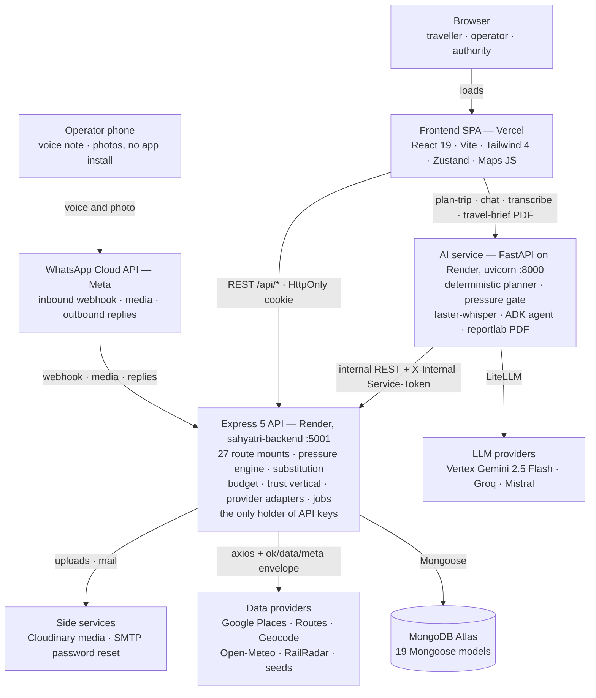
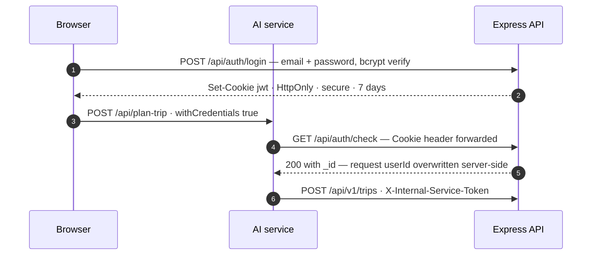
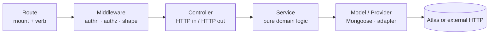
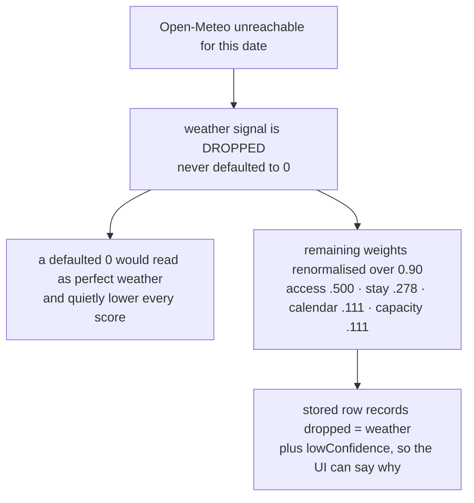
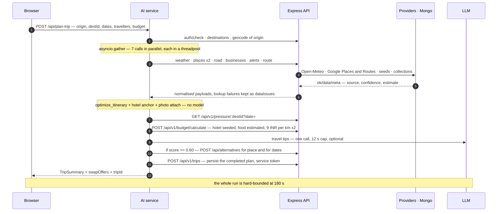
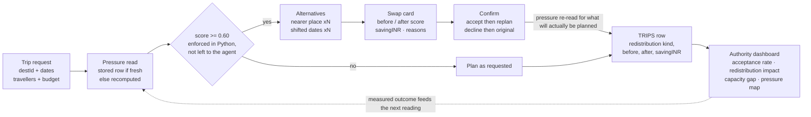
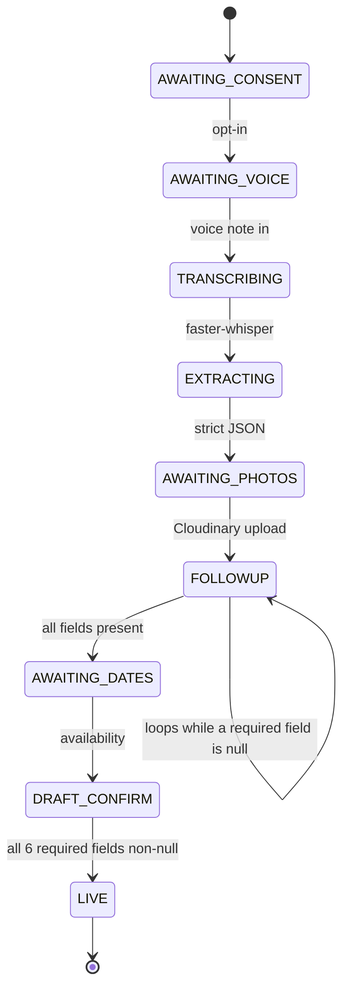

# Sahyatri — System Architecture

**SIH 26204** · branch `feat/multimodal-tourism-agent` · HEAD `2c8e6ed`

A three-service tourism platform whose single product rule is **redistribution**: measure
crowd pressure on a destination for a date, and when it crosses **0.60**, offer the
traveller a nearer place or a shifted date *before* the plan is built.

| | |
|---|---|
| Deployables | 3 + MongoDB Atlas |
| Express route mounts | 27 |
| Mongoose models | 19 |
| Pressure signals | 5, weighted and locked |
| Gate threshold | `PRESSURE_GATE = 0.60` |

> Constants quoted throughout this document — the 0.60 gate, the 180 s ceiling, the
> 0.45/0.25/0.10/0.10/0.10 weights, the 90 s proof-of-visit window, the 20/3/7 waitlist
> limits, ₹9/km, the ₹3,500 nightly baseline — are read from source, not from documentation.
> `PROJECT_OVERVIEW.md` describes only the original auth + budget slice and predates most
> of what is below.

---

## Contents

1. [The system at a glance](#1-the-system-at-a-glance)
2. [Deployment topology](#2-deployment-topology)
3. [Identity across two backends](#3-identity-across-two-backends)
4. [Frontend architecture](#4-frontend-architecture)
5. [Express backend](#5-express-backend)
6. [The pressure engine](#6-the-pressure-engine)
7. [AI service](#7-ai-service)
8. [A plan-trip request, end to end](#8-a-plan-trip-request-end-to-end)
9. [The redistribution loop](#9-the-redistribution-loop)
10. [The trust vertical](#10-the-trust-vertical)
11. [WhatsApp voice onboarding](#11-whatsapp-voice-onboarding)
12. [Data model](#12-data-model)
13. [Jobs, caches and limits](#13-jobs-caches-and-limits)
14. [Repository map](#14-repository-map)

---

## 1. The system at a glance

Three independently deployed processes, one database, and a deliberately thin set of
external providers. Nothing is a monolith by accident: the Express API owns all
persistence and all provider credentials, the FastAPI service owns orchestration and every
model call, and the browser holds no secret except a Maps JS key restricted by HTTP
referrer.



Two arrows leave the browser, not one: the SPA talks to Express for everything CRUD-shaped
and to the AI service directly for planning. Every credential-bearing outbound call
originates in Express — the AI service holds only model keys and a shared service token.

### Why three services and not one

- **Language fit.** The planner needs `faster-whisper`, the Google ADK, LiteLLM and
  reportlab — a Python runtime. The rest of the product is CRUD, aggregation and JWT,
  which Express does with less ceremony.
- **Blast radius.** A hung model call or an exhausted Places quota degrades planning only.
  The trust vertical, the authority dashboard and auth stay up, because they never
  traverse the AI service.
- **Credential containment.** RailRadar, Google Maps, Cloudinary and SMTP keys exist in
  exactly one process. The AI service reaches them only through Express endpoints that
  already normalise and label the responses.
- **Scaling shape.** Planning is bursty and CPU-heavy (Whisper transcription runs in a
  threadpool); the API is steady and I/O-bound. Separate Render services scale on separate
  curves.

---

## 2. Deployment topology

`render.yaml` declares both server-side services as Render web services with health checks;
the SPA ships to Vercel (`frontend/vercel.json`). Every secret is marked `sync: false` —
the file declares which variables must exist, never their values.

| Service | Runtime | Start command | Health | Local port |
|---|---|---|---|---|
| `sahyatri-backend` | Node (ESM) | `npm start` → `src/index.js` | `GET /health` | 5001 |
| `sahyatri-ai-service` | Python 3.12.10 | `uvicorn app.main:app` | `GET /health` | 8000 |
| `frontend` | Vite static build | `vite build` → Vercel CDN | — | 5173 |
| MongoDB Atlas | Managed | `mongoose.connect(MONGODB_URI)` | — | — |

Both `/health` routes are deliberately independent of Mongo, so a database blip does not
take the service out of the load balancer.

### Environment, by owner

| Variables | Owner | Notes |
|---|---|---|
| `MONGODB_URI`, `JWT_SECRET` | backend | JWT signs the auth cookie; nothing else reads it |
| `CLIENT_URL` | backend + AI service | Comma-separated origin allowlist, parsed identically by Express CORS and FastAPI `CORSMiddleware`, so the two can never disagree about who may call them |
| `INTERNAL_SERVICE_TOKEN` | backend + AI service | Compared with `crypto.timingSafeEqual`, never `===` |
| `GOOGLE_MAPS_API_KEY`, `RAILRADAR_API_KEY`, `AMADEUS_*` | backend | The provider adapters are the sole callers |
| `CLOUDINARY_*`, `SMTP_*`, `MAIL_FROM` | backend | With SMTP unset the mailer logs the reset link to stdout, keeping the whole recovery flow testable offline |
| `WHATSAPP_TOKEN`, `WHATSAPP_PHONE_NUMBER_ID`, `WHATSAPP_WEBHOOK_VERIFY_TOKEN` | backend | Webhook verification, media fetch, replies |
| `BACKEND_URL` | AI service | Base URL for internal REST; defaults to `http://localhost:5001` |
| `MODEL`, `GROQ_*`, `MISTRAL_*`, `GOOGLE_API_KEY`, `GOOGLE_CLOUD_*` | AI service | A LiteLLM model id (`provider/model`), not a bare model name |
| `VITE_API_URL`, `VITE_AI_SERVICE_URL` | frontend | Baked in at build time — two base URLs, because the SPA genuinely has two backends |
| `VITE_GOOGLE_MAPS_API_KEY` | frontend | Public by necessity (Maps JavaScript API); must be referrer-restricted in the Cloud Console. The one key that reaches the browser. |

> **Deployment trap, documented in code.** The auth cookie is `SameSite`-scoped and
> `secure` unless `NODE_ENV === "development"`. Frontend and backend sit on different
> origins in production, so if `NODE_ENV` is not `production` on Render, login succeeds and
> every subsequent request comes back 401 — a silent auth loop rather than an error.

---

## 3. Identity across two backends

The hardest boundary in the system is not data — it is session. The browser authenticates
against Express, then calls the AI service, which must know who the caller is without ever
minting or verifying a token itself.



Two distinct credentials, never interchanged. The forwarded cookie answers *who is this
traveller*; the service token answers *is this call coming from our own orchestrator*. A
trip draft created by the AI service is therefore attributable to a real user **and**
unreachable from an arbitrary client.

- **Client-supplied `userId` is never trusted.** When `/api/auth/check` resolves an id,
  `plan_trip` replaces the request `userId` with it; only an unauthenticated caller keeps
  `"guest"`.
- **Draft ownership is re-checked on confirm.** `confirm_trip` returns 403 when an
  authenticated user id does not match the draft owner, so a leaked `tripDraftId` alone
  buys nothing.
- **The offered set is authoritative.** `match_offer` accepts only a `destId` or
  `startDate` that appears in the stored draft; savings and pressure figures come from the
  draft, never from the client claim.
- **`protectRouteOrService`** tries the service token first and falls back to normal cookie
  auth, so `/api/internal/onboarding/upload` and `/api/v1/users/:id/preferences` serve both
  machines and people through one handler.

---

## 4. Frontend architecture

A single Vite SPA with role-branched routing. State is nine small Zustand stores rather
than one global store — each owns the endpoints for a single surface, so a failing section
degrades alone.

### Two API clients, on purpose

`src/lib/api.js` is an axios instance pointed at Express with `withCredentials`, used by
eight of the nine stores. `usePlannerStore` builds its own client against
`VITE_AI_SERVICE_URL` — the AI service is a peer, not something proxied through `/api`, and
pretending otherwise would hide a real network boundary from anyone reading the code.

| Store | Backs | Talks to |
|---|---|---|
| `useAuthStore` | Session, signup/login, profile, role home | `/api/auth/*` |
| `usePlannerStore` | Trip planner, plan results, chat, travel brief | AI service |
| `usePressureStore` | Explore heatmap, full component rows | `/v1/pressure/map` |
| `useSubstitutionStore` | Swap page candidates | `/api/alternatives` |
| `useTripsStore` | My Trips history and detail | `/v1/trips` |
| `useTrustStore` | Proof-of-visit, community, offers, alerts, safety, businesses | 7 endpoint groups |
| `useOperatorStore` | Business registration, waitlist, flash offers, rotating code, hiring | `/v1/businesses` · `/v1/offers` · `/v1/waitlist` · `/v1/visits` |
| `useAuthorityDashboardStore` | Four dashboard panels, each fetched and failed independently | `/v1/dashboard/*` |
| `useDestinationsStore` | Destination catalogue, request-deduplicated and cached in memory | `/api/destinations` |

### Routing and role gates

Guards live in `components/shell/Guards.jsx`: `RequireAuth` (standard page shell),
`RequireAuthBare` (full-bleed canvases like the map and swap flow) and `RequireRole`. Two
routes branch on role at the same URL — `/visits` shows an operator the live rotating code
and everyone else the entry form; `/community` shows an authority the moderation queue and
a traveller the submission form.

> Role gates in the SPA are convenience, not security. `/community/submissions/queued` and
> the review endpoint reject a non-authority server-side regardless of what the client
> renders; the trips summary route is wrapped in `requireRole("authority")`.

- **Public:** `/`, `/signin`, `/signup`, `/forgot-password`, `/reset-password`, `/explore`,
  `/explore/:destId`, `/businesses`, `/alerts`
- **Authenticated:** `/home`, `/multimodal-agent`, `/map`, `/trips`, `/swap`,
  `/trip-confirmation`, `/visits`, `/community`, `/services`, `/notifications`, `/offers`,
  `/safety`, `/profile`
- **Operator:** `/operator`, `/register-business`, `/hire-people`, `/operator/waitlist`
- **Authority:** `/authority`
- **Legacy redirects:** `/login`, `/pressure`, `/planner`, `/map-preview`, `/verify-email`

### Map surface

The densest component family in the repo: `EverythingMap.jsx` composes eleven layers and
panels — destination markers, category markers, current location, places, pressure
heatmap, route polyline, stop picker, travel-mode selector, route details, trip summary and
the AI assistant overlay. `lib/googleMapsLoader.js` injects the Maps JS SDK exactly once
(with `places` and `visualization`) and memoises the promise, so remounting a layer never
re-injects the script tag.

---

## 5. Express backend

`backend/src/index.js` is deliberately boring: load `backend/.env` by absolute path (so the
server starts identically from repo root or from `backend/`), install JSON + cookie + CORS
middleware, expose a Mongo-independent `/health`, mount 27 route groups, then connect to
Mongo and start the alert scheduler.



Worked example — a traveller claims a flash offer:

`/v1/offers POST /:id/claim` → `protectRoute` → `offers.controller` →
`offerService` + `matchingEngine` → `offer.model.findOneAndUpdate` (atomic) → Atlas.

Services are I/O-free where possible — the pressure engine and the budget service are pure
functions with standalone test suites, which is what makes the maths verifiable without a
database. Provider adapters never throw upward; they return `{ ok, data, meta }` carrying
`source`, `confidence` and an `estimate` flag.

### Mounted route groups

| Mount | Purpose | Guard |
|---|---|---|
| `/api/auth` | Signup, login, logout, check, forgot/reset/change password, profile | rate-limited · `protectRoute` |
| `/api/v1/budget` | `POST /calculate` — itemised cost with per-category provenance | `validateBudgetInput` |
| `/api/v1/pressure` | `/map` (all destinations, one date) and `/:destId` | public |
| `/api/weather` `/trains` `/places` `/routes` `/fare` `/road` `/geocode` | Provider passthroughs, envelope-wrapped; `/places/photo` proxies Google photo bytes so the key stays server-side | public |
| `/api/destinations` | Seeded catalogue — 36 destination JSON files | public |
| `/api/alternatives` | Substitution: ranked place and date candidates | public |
| `/api/v1/trips` | Create, list mine, get, patch; `/summary` for authority analytics | owner-scoped · `requireRole` |
| `/api/v1/visits` | Proof-of-visit verify; live operator code | `protectRoute` |
| `/api/community` | Photo upload, submissions, moderation queue, review | `protectRoute` + authority |
| `/api/v1/offers`, `/api/v1/waitlist` | Flash offers, atomic claim, SmartWaitlist entries | `protectRoute` |
| `/api/v1/alerts` | Public advisories, per-trip filtering, ingest | `protectRoute` on ingest |
| `/api/v1/businesses`, `/api/v1/bookings` | Search, register, contact reveal, bookings by user and by business | `protectRoute` |
| `/api/v1/safety` | Emergency contacts, shareable trip token, revoke, complaints | mixed public/protected |
| `/api/v1/dashboard` | Pressure, capacity, redistribution, acceptance | public read |
| `/api/v1/users` | Preferences read (service or user) and write | `protectRouteOrService` |
| `/api/internal/onboarding` | Audio upload fallback path for onboarding | `protectRouteOrService` |
| `/api/webhook/whatsapp` | Meta verification handshake + inbound messages | verify token |

---

## 6. The pressure engine

This is the part of the system everything else is arranged around. A destination's pressure
for a date is a weighted blend of five normalised signals, and the weights are **locked** —
`services/pressure/engine.js` carries a `FORMULA_VERSION` (currently `2`) so a stored row
computed under older weights is treated as stale no matter how recently it was written.

### The locked formula

| Signal | Weight | Source | Normalisation | Varies by date |
|---|---:|---|---|---|
| `access` | 0.45 | RailRadar seat availability + road corridor frequency | Mean waitlist depth of the top-3 arriving services ÷ (2 × baseline), blended with the road side | yes\* |
| `stay` | 0.25 | `stayEstimate.provider` — seeded `hotelMedianINR` lifted by calendar impact | Unavailable fraction and price vs baseline | yes |
| `calendar` | 0.10 | Seeded festival/weekend calendar per state | Direct 0–1 with a label | yes |
| `weather` | 0.10 | Open-Meteo forecast; climate model beyond ~16 days | Comfort pull from max temp and precipitation probability | yes |
| `capacity` | 0.10 | Destination `capacityPrior` | Static by definition | no |

\* The asterisk is a real rule, not a caveat. No road provider in this system returns seat
data — only published timetable frequency — so `collect()` takes the `roadFrequencyProxy`
path, the row is marked `degraded: ["road"]`, and the whole access component becomes static
for that destination. The engine says so in the stored row rather than presenting a
frequency proxy as live occupancy.

### Drop-and-renormalise



A missing signal changes the denominator, not the numerator. The stored row keeps
`dropped`, `degraded`, `lowConfidence` and `stale` alongside the score, and the Explore
heatmap renders that breakdown directly rather than re-fetching per destination.

> **Honesty as an architectural constraint.** Three adapters in `backend/src/providers/`
> report themselves unavailable rather than returning plausible numbers: Amadeus
> (`fail("Amadeus not configured")`), road seat data (frequency only, `estimate: true`,
> `confidence: "low"`) and stay availability (`source: "seed-estimate"`). The authority
> dashboard follows the same rule — `capacityGap` returns `null` per destination when its
> input collection has no writer, rather than computing against an assumed zero.

### Freshness and precomputation

`services/pressure/service.js` serves a stored `destination_pressures` row when it is fresh
**and** on the current `formulaVersion`; otherwise it recomputes. `precomputePressure.job.js`
fills a forward window plus 30 days of backfill so the emerging-hotspot and capacity-gap
analytics have history — and it deliberately overwrites the seeded history rows, which were
generated under pre-lock weights (access 0.35 / weather 0.15 / capacity 0.15) and would
otherwise poison the trend line.

Fetching is separated from arithmetic: `collectors.js` calls injected provider adapters
(`realProviders.js` in the server, `mockProviders.js` for the offline back-test), and
`engine.js` does no I/O at all, which is why `engine.selfcheck.mjs` can verify the formula
standalone.

---

## 7. AI service

Roughly 1,900 lines of FastAPI in `ai-service/app/main.py`, and the important structural
fact is how little of it is the model. The trip plan itself is produced by
`_deterministic_summary()` — no LLM at all. Language models are used only where language is
the product.

### Where the LLM is, and is not

| Use | Detail |
|---|---|
| **Not the planner** | Fan-out, itinerary ordering, costing, the pressure gate, date shifting and schema validation are plain Python. An agent could reason its way out of offering alternatives; a Python `if` cannot. |
| Travel tips | One call per plan, ≤ 12 s, temperature 0.3, structured output. Every number it may mention is passed in; on any failure the field is `None`, never a placeholder string. |
| Ask AI chat | Stateless at the service layer — the browser resends trip + a short window each time. ≤ 15 s, 500 chars, 8 history messages, 20 requests per 10 minutes per user or IP. |
| Multimodal agent | Google ADK `Agent` with plan / hotels / places tools plus pressure and alternates. English, Telugu, Hindi; traveller / operator / authority roles. |
| Onboarding extraction | A single strict-JSON call over a transcript — deliberately *not* the tool-calling agent, because it is one structured extraction, not a multi-step run. |
| Recommendation + brief | Map overlay copy (≤ 10 s, interactive) and the travel brief that `reportlab` renders into `sahyatri-travel-brief.pdf`. |

### Endpoints

| Endpoint | Does | Bound |
|---|---|---|
| `POST /api/plan-trip` | Full deterministic plan + swap offers + draft persistence | 180 s |
| `POST /api/plan-trip/confirm` | Accept or decline an offered swap, replan, record redistribution | 180 s |
| `POST /onboarding/transcribe` | faster-whisper in a threadpool → transcript + detected language | — |
| `POST /onboarding/extract` | Transcript → strict business/worker JSON | — |
| `POST /internal/ai/recommendation` | Map overlay copy from supplied facts | 10 s |
| `POST /internal/ai/chat` | Ask AI about the current trip | 15 s |
| `GET /api/multimodal/meta` | Supported languages and roles | — |
| `POST /api/multimodal/transcribe` | Voice input for the multimodal agent | — |
| `POST /api/multimodal/chat` | Agent turn — `en` · `te` · `hi` | — |
| `POST /internal/ai/travel-brief` | Structured brief: explanation, weather, advice, hidden gems | — |
| `POST /internal/travel-brief/pdf` | Same brief, rendered as a PDF stream | — |
| `GET /health` | Render health check | — |

### Failure engineering

Two production incidents are visible in the code as permanent structure:

- Every call in `backend_client.py` sends `Connection: close`, because a pooled keep-alive
  socket to a backend that died abruptly could hang past the 5-second timeout at a layer
  the `timeout=` kwarg does not reach.
- The entire agent run carries a hard 180-second ceiling on top of the per-call timeouts,
  because bounded parts can still compose into an unbounded whole.

Beyond that, every enrichment is independently optional: costing, local fare, swap offers,
travel tips and history persistence each fail closed to `None` and log. The only failures
that reach the traveller as an error are a missing destination, an ungeocodable origin, or
the global timeout — and all of them surface one calm sentence, with the technical cause
carried separately in `detail`.

---

## 8. A plan-trip request, end to end



**The fan-out is the design.** Seven provider-backed lookups run concurrently with
`return_exceptions=True`, so one failure becomes a `dataIssues` string ("the daily Google
Places quota is exhausted") rather than a failed plan. Costing, tips and swaps are then
sequential because each depends on the assembled itinerary.

### Deterministic details worth knowing

- **Inclusive dates.** Dec 26–28 is a three-day trip; nights are `days − 1` and rooms are
  `ceil(travellers / 2)`.
- **Local transport is local.** Fare is priced off the haversine sum of each day's
  stop-to-stop loop at 25 km/h, never the intercity route distance — city auto/cab rates
  applied to a 537 km leg would be wildly wrong.
- **No invented stops.** When Places returns nothing, the planner falls back to a curated,
  named list for that destination — and a destination with no curated entry gets an empty
  day, not generated pins like "main attractions" at the centroid.
- **Photos cost nothing extra.** The two Places searches already request `places.photos`; a
  post-pass indexes them by name and merges `placeId` / `photoUrl` onto itinerary entries,
  leaving the itinerary engine untouched.
- **Trains are not faked.** RailRadar prices a specific train number between two stations,
  and nothing here knows which trains serve a corridor — so the response carries the nearest
  railhead with `seatAvailabilityChecked: false` and says why.
- **Validation at the boundary.** `travellers` 1–20, `budgetINR > 0`, real ISO calendar
  dates, `endDate >= startDate` — rejected as a free 422 before a single backend call or
  model token is spent.

---

## 9. The redistribution loop

Everything above exists to close this loop. Pressure is measured, a gate fires,
alternatives are offered, a decision is recorded on the trip, and the authority dashboard
reports what proportion of offers were taken and what that moved.



**The gate is code, not a prompt.** `PRESSURE_GATE = 0.60` lives in Python precisely so no
model decision can skip it. A null score — every component dropped, an untracked
destination, a transport failure — is never treated as "low"; planning simply proceeds as
it did before gating existed.

### Substitution ranking

`services/substitution/` splits the work into `filters`, `distance`, `ranking`,
`standardize` and `dateSubstitution`. Candidate savings are computed as the real budget
difference between requested and candidate destination — two calls to the same budget
function the trip card uses, so a saving quoted on a swap card and a cost quoted on a trip
can never disagree. Both the Express fallback and the AI service default to the same
₹3,500 nightly baseline for exactly that reason.

On confirm, the "after" pressure is re-read for the destination and date that will actually
be planned, rather than trusting the figure quoted in the offer — the offer was computed
when the draft was created and is client-visible in between. Combined place-and-date swaps
read one fresh score for the combined pair; the score is never derived by subtracting two
others.

---

## 10. The trust vertical

A cluster of features that make supply-side claims verifiable. They share the backend
service layout and are surfaced through `useTrustStore` and `useOperatorStore`.

### Proof of visit

An operator console displays a six-digit code derived from
`HMAC-SHA256(businessId, step)` where `step = floor(now / 90 s)`. The traveller types it
in; the backend recomputes and compares. A rotating window defeats the obvious attack —
screenshotting a static QR and sharing it — without requiring either side to be online at
the same instant beyond the window. The frontend polls the operator code because it
genuinely expires every 90 seconds.

### SmartWaitlist and flash offers

| Rule | Value | Why |
|---|---|---|
| Recipients per offer | ≤ 20 | An offer with real inventory behind it, not a broadcast |
| Flash notifications per user | 3 per 24 h | Notification fatigue is the failure mode that kills the channel |
| Decline cooldown | 7 days | Declining the same destination twice in a week is a signal, not noise |
| Match criteria | `destId` · date overlap · `maxPriceINR >= price` | "Nearby" means the same canonical destination slug |
| Ranking | budget headroom × recency | Most likely to convert, first |
| Claim | `findOneAndUpdate` | Atomic — two travellers cannot claim one seat |

### Community, safety and alerts

- **Submissions** flow through Cloudinary photo upload, a queue, and an authority-only
  review endpoint; `similarityUtils` guards against duplicate places under different names.
- **Shareable trips** mint a revocable token; `GET /v1/safety/trips/share/:token` is public
  by design so a family member needs no account, and revocation is a first-class endpoint
  rather than a deletion.
- **Emergency contacts** are served per destination; complaints are submitted by travellers
  and listed back to their author only.
- **Alerts** are polled from Open-Meteo, and only Open-Meteo — the code notes plainly that
  the other three sources named in the spec (state road status, monument closures, district
  notices) have no machine-readable feed, rather than shipping an empty adapter that looks
  implemented.
- **Notifications** are not a separate collection: the store filters the alert set down to
  destinations the traveller actually has a trip to, with overlapping dates.

---

## 11. WhatsApp voice onboarding

The onboarding path exists because the supply side — a homestay owner in a hill town — will
not install an app or fill a web form, but will send a voice note. A nine-state machine
drives the conversation, and it is pure logic: no WhatsApp calls, no transcription, no
model calls live in it.



**Two hard gates.** Idempotency keyed on `lastWhatsAppMessageId` (Meta's wamid), so a
retried webhook can never advance state twice; and a required-field check before
`DRAFT_CONFIRM → LIVE`: `name`, `type`, `capacity`, `priceRangeINR`, `nearestLandmark` and
`destId`. The sixth is not in the written spec — it is there so the state machine and the
Mongoose schema's conditional requiredness cannot disagree and produce a transition that
"applied" but failed at the database layer.

The real webhook path and the internal fallback endpoint converge into one pipeline. An
inbound audio message fetches media bytes from Meta, then hands them to the same
`processInboundAudio.js` that `/api/internal/onboarding/upload` uses — there is no second
implementation of transcribe → validate → transition → persist. Meta batches `entry`,
`changes` and `messages` as arrays, and all three are iterated; delivery-receipt payloads
carry `statuses` instead of `messages` and simply produce no work.

---

## 12. Data model

Nineteen Mongoose models, grouped by the concern that writes them. The trip document is the
join point between planning and analytics: the AI service writes drafts and completions
through `/api/v1/trips`, and the dashboard reads redistribution outcomes back off the same
rows.

| Group | Collections | Written by |
|---|---|---|
| Identity | `user` · `authToken` · `auditLog` | Auth controller, password recovery, alert ingest |
| Planning | `trip` · `budget` · `shareableTrip` | AI service via internal REST; budget controller persists non-blockingly |
| Pressure and demand | `destinationPressure` · `destinationDemand` · `alternativeSuggestion` | Pressure service, precompute job, substitution |
| Supply | `business` · `businessAvailability` · `booking` · `visit` | Operator console, WhatsApp onboarding, proof-of-visit |
| Demand shaping | `offer` · `waitlist` | Offer service + matching engine; TTL index reaps expired offers |
| Trust and safety | `alert` · `complaint` · `communitySubmission` | Poll job, safety controller, moderation queue |

> **Known gap, deliberately visible.** `destination_demand` has no writer anywhere in the
> codebase, and `business_availability` holds no documents. Rather than let the dashboard
> compute a gap against an implied zero — which would render as a real number — both
> metrics return `null` per destination when their input is genuinely absent. The
> unfinished half of the feature is legible in the API response instead of hidden by a
> plausible figure.

Also worth noting:

- `socket.io` is declared in `backend/package.json` but has no import anywhere in `src/` —
  there is no realtime channel in the running system today.
- Destinations are not a collection: 36 JSON files under `src/seeds/destinations/` are the
  catalogue, loaded by `loadDestinations()` and served through `/api/destinations`.
- `Budget` is written with `bufferCommands: false` and a fire-and-forget `.catch()`, so a
  disconnected Mongo cannot make a pure calculation hang.

---

## 13. Jobs, caches and limits

### Background work

| Job | Trigger | Does |
|---|---|---|
| `pollAlerts` | On boot, then every 6 h (unref'd timer) | Open-Meteo-derived advisories → `alert` + `auditLog`. A failed run logs and never crashes the server. |
| `precomputePressure` | CLI | Forward window plus 30-day backfill under the locked weights, overwriting pre-lock seeded history. |
| `expireOffers` | CLI | Keeps `status` honest between claim-time filtering and the Mongo TTL reaping the document. |
| `seedDatabase` | `npm run seed` | Destinations, businesses, availability, calendar, fares, pressure history. |

Only the alert poller runs inside the web process — wired in `scheduler.js` because the job
previously existed as a CLI script nothing invoked, which meant a normal deployment served
an empty alerts collection forever.

### Caching and rate limits

| Limit | Value | Rationale |
|---|---|---|
| Places text search cache | 10 min | A traveller's whole session collapses into one billed search; short enough that ratings do not go visibly stale |
| Place photo cache | 24 h, capped at 32 MB | Photo bytes are immutable, so capped by total size rather than entry count; an uncapped cache is a slow leak |
| Auth rate limits | `express-rate-limit` | Separate limiters on signup, login, forgot-password and reset-password |
| Ask AI | 20 per 10 min | Keyed by user id, falling back to IP |
| Backend client timeout | 5 s | Every AI-service → Express call, with `Connection: close` |
| Agent run ceiling | 180 s | A hard ceiling over the whole fan-out, independent of the per-call timeouts underneath it |

### Engineering discipline

A version-controlled `.githooks/commit-msg` enforces Conventional Commits (with automatic
bypass for merge, squash and fixup), installed via `npm run prepare-hooks` or the
cross-platform scripts in `scripts/`. Jest covers the pure layers — budget service and
validator, pressure engine self-check, substitution, waitlist matching, proof-of-visit,
community, feedback, the onboarding state machine and the WhatsApp webhook — using
`mongodb-memory-server` where a database is genuinely needed.

---

## 14. Repository map

```
SIH_26204/
├── frontend/                 # React 19 · Vite · Tailwind 4 → Vercel
│   └── src/
│       ├── components/
│       │   ├── map/          # EverythingMap + 11 layers/panels, markerIcons, travelModes
│       │   ├── planner/ ai/  # TripPlanner · MultimodalTravelAgent
│       │   ├── swap/         # SwapCard, Place/Date variants, TripConfirmation
│       │   ├── pressure/     # heatmap, India map, rings, scoreColor, projection
│       │   ├── trust/        # visits · community · offers · alerts · safety · businesses
│       │   ├── operator/     # console, register, hire, waitlist, verify-visit
│       │   ├── authority/    # dashboard, capacity gap, redistribution, acceptance
│       │   └── auth/ profile/ trips/ destinations/ shell/ ui/
│       ├── store/            # 9 Zustand stores
│       └── lib/              # api.js · googleMapsLoader · travelBrief · labels
│
├── backend/                  # Express 5 · Mongoose → Render
│   └── src/
│       ├── index.js          # 27 mounts, CORS allowlist, /health, scheduler
│       ├── routes/           # one file per mount
│       ├── controllers/      # HTTP in / HTTP out only
│       ├── middleware/       # auth · requireRole · serviceAuth · rate limit · validation
│       ├── services/
│       │   ├── pressure/     # engine · collectors · providers · service · stats · seed
│       │   ├── substitution/ # filters · distance · ranking · dateSubstitution
│       │   ├── waitlist/ incentive/ dashboard/ community/ feedback/
│       │   └── alerts/ pov/ onboarding/   # state machine + 12 step modules
│       ├── providers/        # googlemaps · openmeteo · railradar · roadtransport ·
│       │                     # geocode · fareEstimator · stayEstimate · amadeus
│       ├── models/           # 19 Mongoose schemas
│       ├── jobs/             # scheduler · pollAlerts · precomputePressure · expireOffers
│       └── seeds/            # 36 destinations + businesses, fares, calendar, history
│
├── ai-service/               # FastAPI · uvicorn → Render
│   └── app/
│       ├── main.py           # 12 endpoints, deterministic planner, gate, PDF
│       ├── agents/           # travel_agent · multimodal_agent (Google ADK)
│       ├── tools/            # 14 backend-backed tools
│       ├── onboarding/       # transcribe (faster-whisper) · extraction_prompt
│       ├── services/         # backend_client · trip_drafts
│       └── pdf_builder.py    # reportlab travel brief
│
├── render.yaml               # both server services, health checks, secret declarations
├── .githooks/commit-msg      # Conventional Commits enforcement
└── scripts/                  # hook setup · backtest · distance calibration
```
