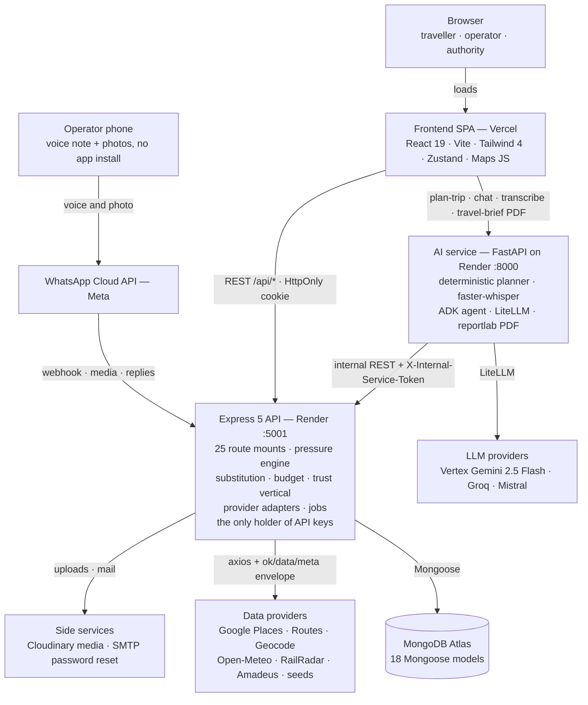
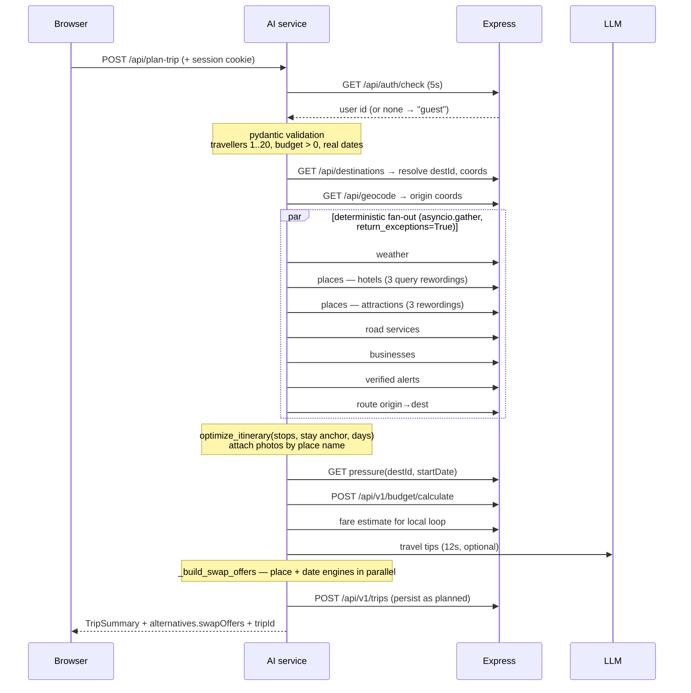

# Sahyatri — Complete Project Documentation

**SIH 26204** · branch `fix/selectable-trip-alternatives` · HEAD `16e5a90`

Every number, formula, threshold, route and field in this document was read out of the
source tree at that commit. Where the code disagrees with an older document in this repo,
the code wins and the disagreement is called out explicitly (see
[§14 Known gaps](#14-known-gaps-and-inconsistencies)).

---

## Contents

1. [What the product does](#1-what-the-product-does)
2. [Service topology](#2-service-topology)
3. [Repository map](#3-repository-map)
4. [Technology stack](#4-technology-stack)
5. [Identity and authorization](#5-identity-and-authorization)
6. [The pressure engine](#6-the-pressure-engine)
7. [The redistribution engine](#7-the-redistribution-engine)
8. [AI service](#8-ai-service)
9. [A plan-trip request, end to end](#9-a-plan-trip-request-end-to-end)
10. [The trust vertical](#10-the-trust-vertical)
11. [WhatsApp voice onboarding](#11-whatsapp-voice-onboarding)
12. [Frontend](#12-frontend)
13. [Data model](#13-data-model)
14. [Known gaps and inconsistencies](#14-known-gaps-and-inconsistencies)
15. [Complete API surface](#15-complete-api-surface)
16. [Configuration](#16-configuration)
17. [Running locally](#17-running-locally)
18. [Deployment](#18-deployment)
19. [Testing](#19-testing)

---

## 1. What the product does

Sahyatri is a tourism platform built around one idea: **redistribution**. Indian
destinations do not have a tourism shortage, they have a *distribution* problem — Manali
on a long weekend is saturated while Jibhi, two hours away, is empty.

The platform quantifies that saturation as a **pressure score** in `[0, 1]` for a
`(destination, date)` pair, and uses it to move demand:

| Actor | What they get |
|---|---|
| **Traveller** | A full trip plan, plus swap cards offering a quieter destination or a shifted date, with the crowding drop and rupee difference stated |
| **Operator** | A business listing reachable by WhatsApp voice note (no app install), plus waitlists and flash offers to fill unsold inventory |
| **Authority** | A dashboard of pressure by destination, capacity gaps, redistribution impact and the acceptance rate of offered alternatives |

The three roles are one codebase and one login (`user.role` is `traveller | operator |
authority`), with role-gated routes on the frontend and role checks on the backend.

### The scale of what is built

| | |
|---|---|
| Deployable services | 3 (frontend, Express API, FastAPI AI service) + MongoDB Atlas |
| Express route mounts | 25 |
| HTTP endpoints (Express) | 64 |
| Mongoose models | 18 |
| Seeded destinations | 36 |
| React components | 79 |
| Zustand stores | 10 |
| Test files | 33 (31 Jest + 2 pytest) |
| Pressure signals | 5, weighted and version-locked |

---

## 2. Service topology

Three independently deployed processes, one database, and a deliberately thin set of
external providers.



Two arrows leave the browser, not one: the SPA talks to Express for everything
CRUD-shaped, and to the AI service directly for planning, chat and PDF generation. Every
credential-bearing outbound call originates in Express — the AI service holds only model
keys and a shared service token.

### Why three services

- **Language fit.** The planner needs `faster-whisper`, the Google ADK, LiteLLM and
  `reportlab` — a Python runtime. The rest of the product is CRUD, aggregation and JWT,
  which Express does with less ceremony.
- **Blast radius.** A hung model call or an exhausted Places quota degrades planning only.
  The trust vertical, the authority dashboard and auth stay up, because they never
  traverse the AI service.
- **Credential containment.** RailRadar, Google Maps, Amadeus, Cloudinary and SMTP keys
  exist in exactly one process. The AI service reaches them only through Express endpoints
  that already normalise and label the responses.
- **Scaling shape.** Planning is bursty and CPU-heavy (Whisper transcription runs in a
  threadpool); the API is steady and I/O-bound.

---

## 3. Repository map

```
SIH_26204/
├── backend/                      Express 5 API — all persistence, all provider keys
│   └── src/
│       ├── index.js              25 route mounts, CORS, /health, alert-poll bootstrap
│       ├── controllers/          16 controllers
│       ├── routes/               25 route modules
│       ├── models/               18 Mongoose schemas
│       ├── middleware/           protectRoute · requireRole · serviceAuth · rate limits
│       ├── lib/                  jwt · db · envelope · ttlCache · mailer · cloudinary
│       ├── providers/            googlemaps · openmeteo · railradar · amadeus ·
│       │                         geocode · roadtransport · fareEstimator · stayEstimate
│       ├── services/
│       │   ├── pressure/         the scoring engine (engine · collectors · service · seed)
│       │   ├── substitution/     place swaps (filters · ranking · distance · standardize)
│       │   ├── alternatives/     suggestion persistence
│       │   ├── onboarding/       WhatsApp voice pipeline (13 modules, 13 test files)
│       │   ├── pov/              proof-of-visit (crypto · validation · service)
│       │   ├── waitlist/         matching engine · offer service
│       │   ├── community/        submissions · similarity
│       │   ├── alerts/           advisories · complaints · shareable trips
│       │   ├── feedback/         growth ranking · translation
│       │   ├── incentive/        eligibility · room demand gap
│       │   ├── dashboard/        capacity gap · trips analytics
│       │   └── budgetService.js  the locked cost formula
│       ├── jobs/                 pollAlerts · precomputePressure · expireOffers · scheduler
│       └── seeds/                36 destinations + calendar, businesses, availability,
│                                 fares, pressure_history
├── ai-service/                   FastAPI planner and agent surface
│   └── app/
│       ├── main.py               1,903 lines — every HTTP endpoint and the planner
│       ├── agents/               travel_agent · multimodal_agent (Google ADK)
│       ├── tools/                14 tool wrappers over Express endpoints
│       ├── onboarding/           faster-whisper transcription · extraction prompt
│       ├── services/             backend_client · trip_drafts
│       └── pdf_builder.py        reportlab travel-brief renderer
├── frontend/                     React 19 SPA
│   └── src/
│       ├── App.jsx               all routing and role gates
│       ├── components/           79 components in 12 feature folders
│       ├── store/                10 Zustand stores
│       ├── pages/                LandingPage · MapPreview
│       └── lib/                  api · googleMaps · destinations · passwordPolicy
├── render.yaml                   Render blueprint for both backends
├── .githooks/                    conventional-commit enforcement
└── docs                          README · ARCHITECTURE · IMPLEMENTED_FEATURES ·
                                  API_CONTRACTS · DEPLOYMENT · PROJECT_OVERVIEW
```

---

## 4. Technology stack

### Frontend (`frontend/package.json`)

| | |
|---|---|
| React | 19.2 |
| Vite | 8.2 |
| Tailwind CSS | 4.3 (via `@tailwindcss/vite`) |
| Routing | react-router-dom 7.18 |
| State | Zustand 5.0 |
| HTTP | axios 1.20, `withCredentials: true` |
| Icons | lucide-react |
| Maps | Google Maps JavaScript API, loaded at runtime |

No TypeScript — the project is plain JSX with ESLint 10 and the react-hooks plugin.

### Backend (`backend/package.json`)

| | |
|---|---|
| Runtime | Node.js, ESM (`"type": "module"`) |
| Framework | Express 5.1 |
| ODM | Mongoose 8.15 |
| Auth | jsonwebtoken 9, bcryptjs 3, cookie-parser |
| Rate limiting | express-rate-limit 8.7 |
| Uploads | multer 2.3 → Cloudinary 2.6 |
| Mail | nodemailer 10 |
| Realtime | socket.io 4.8 (dependency present) |
| Tests | Jest 30 + mongodb-memory-server 11 |

### AI service (`ai-service/requirements.txt`)

| | |
|---|---|
| Framework | FastAPI + uvicorn |
| Model routing | LiteLLM (one model string across every call site) |
| Agent framework | Google ADK (`google.adk.agents.Agent`, `InMemoryRunner`) |
| Speech-to-text | faster-whisper, run in a threadpool |
| PDF | reportlab (A4 brief with an embedded QR code) |
| Validation | pydantic v2 |

Default model is `vertex_ai/gemini-2.5-flash`; `render.yaml` documents a
Groq → Mistral → Gemini fallback chain, with Gemini last-resort because its free tier caps
at 20 calls/day.

---

## 5. Identity and authorization

### Browser sessions

Login issues a JWT in an **HttpOnly cookie** named `jwt`. The browser never reads or
stores a token; `axios` is configured with `withCredentials: true` and the cookie rides
along automatically.

`protectRoute` ([auth.middleware.js](backend/src/middleware/auth.middleware.js)) does four
things in order:

1. Reject when no cookie is present → **401**.
2. `jwt.verify` inside its own try/catch → a malformed, tampered or expired token is
   **401**, not the 500 it used to produce (`jwt.verify` *throws*, it never returns falsy,
   so the old `if (!decoded)` guard was dead code).
3. Reject when Mongo is not connected → **503**, not a misleading auth failure.
4. Compare `decoded.tokenVersion` against `user.tokenVersion` → **401** on mismatch.

**Token versioning** is the revocation mechanism. A plain JWT has no server-side
revocation, so `user.tokenVersion` is incremented on password reset and password change;
every token issued before that moment fails step 4. Sessions predating the feature (no
`tokenVersion` claim at all) also fail — a one-time forced re-login is the correct outcome
for a token the check cannot vouch for.

### Service-to-service

The AI service authenticates to Express two ways:

- **On behalf of a user** — it forwards the browser's `Cookie` header to
  `GET /api/auth/check`. `authenticated_user_id()` in `main.py` resolves it to a user id,
  or `None`, in a threadpool with a 5-second timeout. A resolved id **overwrites** the
  client-supplied `userId` on the request, so a client cannot plan a trip into someone
  else's history.
- **As itself** — `X-Internal-Service-Token`, compared with
  `crypto.timingSafeEqual` in [serviceAuth.middleware.js](backend/src/middleware/serviceAuth.middleware.js).
  `protectRouteOrService` accepts either a valid service token *or* a valid browser
  session, so the trips persistence seam works for both callers.

### Role gates

`requireRole` guards operator and authority endpoints server-side. The frontend also
branches on `authUser.role`, but [App.jsx](frontend/src/App.jsx) is explicit that this is a
UI convenience, not a security control — the backend remains the authority on every call.

Two routes deliberately branch on role at the *same* URL:

- `/visits` — an operator sees the rotating-code display, everyone else sees the
  code-entry form.
- `/community` — an authority sees the moderation queue, everyone else sees the
  submission form.

---

## 6. The pressure engine

The core measurement. Lives in [backend/src/services/pressure/](backend/src/services/pressure/),
split so the maths is pure and testable: `engine.js` does no I/O at all, `collectors.js`
fetches, `service.js` caches and serves.

### The locked formula

Five signals, weights fixed and versioned ([engine.js:12-25](backend/src/services/pressure/engine.js#L12-L25)):

| Signal | Weight | Kind | What it measures |
|---|---|---|---|
| `access` | **0.45** | date-varying | Rail waitlist depth blended with road demand |
| `stay` | **0.25** | date-varying | Hotel unavailability and price inflation |
| `calendar` | **0.10** | date-varying | Festival/holiday impact from the seeded calendar |
| `weather` | **0.10** | date-varying | Pleasantness *raises* travel intent, so it raises pressure |
| `capacity` | **0.10** | static | The destination's historical demand prior |

`FORMULA_VERSION = 2`. A stored row carries its version, and a row computed under earlier
weights is **always** treated as stale however recent it is — it can never masquerade as
current.

### Per-signal normalisation

**`railDemand`** — mean waitlist depth of the top-3 most-subscribed arriving services,
normalised against `2 × baseline.railWL` and clamped to `[0,1]`.

**`stayScarcity`** — `0.5 × unavailFrac + 0.5 × clamp01(medianPriceINR / (1.5 × baseline.hotelMedianINR))`.

**`weatherPull`** — `tempScore × rainScore`, where `tempScore` is 1.0 inside 15–28 °C
falling linearly to 0 at ±7 °C outside the band, and `rainScore` is 1.0 below 20 %
precipitation probability falling to 0 by 70 %.

**`accessDemand`** — one component blending rail and road at ratio `c`. If only one side
resolves, it leans fully on the survivor; if both fail it returns `null`.

**`roadFrequencyProxy`** — the road provider returns schedule frequency, not seat
availability, so road demand cannot vary by date. The engine falls back to the
destination's static `capacityPrior`, sets `degraded: ["road"]`, and moves the entire
`access` component from the date-varying bucket to the static one. `roadDemand()` (the
real seat-occupancy normaliser) is written and tested but currently unreachable — kept for
when a seat-data source exists.

### Drop-and-renormalise

A signal that cannot be retrieved is **dropped, never defaulted**. Defaulting a missing
signal to 0.5 would invent data; dropping it and renormalising the survivors' weights is
honest about what was actually measured:

```js
const total = parts.reduce((s, p) => s + p.weight, 0);
if (total === 0) return null;              // nothing retrievable → no score, not zero
const score = parts.reduce((s, p) => s + p.value * (p.weight / total), 0);
```

Consequences encoded in the stored row:

- **All five dropped** → `score: null` and `lowConfidence: true`. Never `0`.
- **More than 0.40 of total weight dropped** → `lowConfidence: true`.
- `dateVaryingSubtotal` and `staticSubtotal` record the effective weight split, so a
  consumer can see how much of a score actually responded to the date.

### Freshness and serving

[service.js](backend/src/services/pressure/service.js) applies a two-condition freshness
test — a row is fresh only if it is **under 24 hours old** *and* on the **current formula
version**. On a miss it recomputes live against a **4-second** budget (`LIVE_TIMEOUT_MS`),
and on timeout falls back to the newest stored row flagged `stale: true`. The demo path
never blocks on a five-provider fetch.

`getPressureMap(date)` serves the whole heatmap for one date and deliberately does not
recompute live for every destination.

### Derived analytics

- **`emergingHotspot`** — linear regression over 14 days of history; a destination is
  emerging when `slope > 0.02`, current score `< 0.5`, and `capacityPrior > 0.5`. Trending
  up, not yet saturated, with real capacity behind it.
- **`normalizedCapacityGap`** — `pressure − supplyRatio`, both on 0–1 so they subtract
  cleanly. Distinct from the raw-room-count `roomDemandGap` in the incentive service.

---

## 7. The redistribution engine

Two independent substitution axes, both in [backend/src/services/substitution/](backend/src/services/substitution/).

### Place substitution — a three-filter funnel

Candidates pass through [filters.js](backend/src/services/substitution/filters.js)
sequentially:

1. **Similarity** — attribute distance over the destination's `attrs` vector (snow, trek,
   heritage, nightlife, food, wildlife, spiritual, riverside), weighted by the traveller's
   `interests`. Keep `dist ≤ d*`. The requested destination is excluded from its own
   candidate pool.
2. **Reachability** — keep candidates whose travel time is `≤ 1.3 ×` the requested
   destination's. When live routing fails for either end, the candidate is **kept** but
   flagged `isTravelTimeFallback: true` with `travelTimeRatio: null` — deliberately *not*
   set to 1, so the UI can say the number is an estimate rather than quietly presenting a
   fallback as a measurement.
3. **Relief** — keep candidates where `candidatePressure ≤ requestedPressure − 0.30`. If
   that yields nothing, the filter re-runs **relaxed at −0.20** and the response carries
   `relaxedRelief: true`.

Survivors are scored in [ranking.js](backend/src/services/substitution/ranking.js):

```
score = (1 − d/d*) × (1 − pressureCandidate) × normalizedSaving
```

`normalizedSaving` is the candidate's rupee saving over the pool maximum, defaulting to 1
(neutral) when no candidate saves anything. Top **3** are returned, ranked.

Because the score multiplies similarity and cost against crowding, an alternative can
legitimately score *higher* on pressure than the original. The AI service's fact builder
handles this explicitly rather than emitting a nonsensical "negative less crowded"
(see [§8](#anti-hallucination-the-fact-list)).

### Date substitution — a fallback ladder

[dateSubstitution.js](backend/src/services/substitution/dateSubstitution.js) scans **±7
days** around the requested date (14 candidates, excluding day 0), reading pressure for
each, then walks a three-rung ladder:

| Rung | Test | Label |
|---|---|---|
| 1 | `pressure ≤ base − 0.25` | "Significant relief" |
| 2 | `pressure ≤ base − 0.15` | "Moderate relief" |
| 3 | the single lowest-pressure date | "Modest relief: *N* lower pressure" |

Survivors are ranked on `pressureDrop × 0.6 + normalizedSaving × 0.4` and the top **2**
returned. The ladder guarantees the traveller is always offered *something*, with the label
stating honestly how much relief it actually represents.

### Where redistribution surfaces

After a plan is built, `_build_swap_offers()` in `main.py` runs both engines in parallel
and attaches `trip.alternatives.swapOffers` with three shapes: `destination_swap`,
`date_swap`, and `combined`. When both a place and a date option exist, the combined
pressure is **read fresh for that candidate pair** — it is never computed by subtracting
two scores.

Swap offers are explicitly non-blocking: a provider timeout inside this function logs a
warning and serves the trip without swaps. As of `16e5a90` these cards are selectable in
the trip planner.

---

## 8. AI service

FastAPI, one file for the surface (`app/main.py`, 1,903 lines) plus tool wrappers.

### Where the LLM is, and is not

This is the service's central design decision. **The trip plan itself is computed without
an LLM.** `_deterministic_summary()` fans out to weather, Places (hotels), Places
(attractions), road services, businesses, alerts and routing, then assembles the itinerary
with `optimize_itinerary()` — plain Python over provider data.

The model is used for four bounded, garnish-level jobs, each with its own timeout:

| Endpoint / call | Timeout | Job |
|---|---|---|
| `_generate_travel_tips` | **12 s** | One 45–70 word practical paragraph per trip |
| `/internal/ai/recommendation` | **10 s** | Explain a swap card from a supplied fact list |
| `/internal/ai/chat` (Ask AI) | **15 s** | Answer one question grounded in the current trip |
| `/api/multimodal/chat` | **90 s** | The ADK tourism agent (tool-calling) |
| `/onboarding/extract` | — | Structured extraction from a voice transcript |
| `/internal/ai/travel-brief` | — | The PDF brief's structured content |

Every one of these fails to `None` or a 503 rather than taking the trip down with it.
Travel tips are the clearest case — the docstring says it plainly: *"travel tips are a
garnish on a plan that must still be served if the model is slow or down."*

### Anti-hallucination: the fact list

`_recommendation_facts()` is the whole anti-hallucination mechanism for the swap-card
bullets. Rather than handing the model nested dicts and hoping, **every comparison the
bullets are allowed to make is computed in Python first** — the percentage crowding drop,
the rupee difference, the travel-time ratio, the forecast high. The model's job is reduced
to phrasing those lines, and the prompt says explicitly that a number not in the list does
not exist.

The same discipline appears in the travel-brief prompt, which is told that
`trip.weather.source == "seasonal-normal"` means a *climate normal*, not a forecast, and
must be described as "typical for late December" — never "the forecast says". And that
`precipMm` is millimetres of rainfall, not a percentage chance of rain.

### Honest failure: `dataIssues`

An exhausted Places quota and a destination that genuinely has no listed stays both
produce `hotels: []`. Without a distinction the UI shows "no listings" for both.
`_note_lookup_failure()` captures the difference while the provider envelope is still
intact and emits human-readable strings:

- `"Stays could not be loaded: the daily Google Places quota is exhausted"`
- `"Attractions could not be loaded: this API key is not authorised for the Places API"`

Similarly, `_curated_fallback_stops()` returns an **empty** list for a destination with no
curated entry rather than generating plausible-sounding stops. The comment records why:
the previous default produced strings like *"Manali, Himachal Pradesh main attractions"* —
names that read like real places but name none, pinned at the destination centroid. An
honest empty day beats a plan full of places that do not exist.

### Failure engineering

- **`AGENT_RUN_TIMEOUT_S = 180`** — a hard ceiling on the whole run, applied at *two*
  levels (`plan_or_500` and `plan_trip`). Added after a live run degraded into a 30 s and
  then a further 15 s hang with zero response when a backend dependency dropped mid-run.
  Per-call timeouts in `backend_client.py` (5 s each) were not enough; nothing bounded the
  run as a whole.
- **Request validation at the boundary** — `travellers` is `ge=1, le=20`, `budgetINR` is
  `gt=0`, and dates are regex- plus calendar-validated with `endDate ≥ startDate`. Each
  constraint traces to a specific QA finding: `travellers ≤ 0` used to reach the full
  pipeline and burn an LLM call before failing; `travellers = 999999` was accepted outright
  and produced an LLM-authored "not feasible" summary standing in for real validation;
  `"notadate"` reached the pressure gate and persisted a corrupted trip draft.
- **User-facing vs technical errors** — `PLAN_FAILED_MESSAGE` is what a traveller (or a
  judge watching the demo) sees; the technical cause still travels in `detail` so a
  captured response is debuggable, but it is never the headline.
- **Error class discrimination** — `LookupError` → **503** (a transient dead end, not a
  broken request); anything unclassified → **500** (it may well be our own defect).
- **Ask AI rate limiting** — process-local, **20 requests per 10 minutes** per user or IP,
  message capped at 500 characters, history window at 8 messages.

### Agents

Two ADK agents exist. `travel_agent.py` is the original full planner. `multimodal_agent.py`
is a deliberately narrower Phase-1 agent with three user-facing capabilities (plan, hotels,
places) that can also reach the pressure and alternatives tools. It resolves human place
names through the destination catalogue first, then backend geocoding — users never supply
coordinates. It answers in **English, Telugu or Hindi**, and its sessions are ephemeral:
the browser sends a short history each request and nothing is persisted.

---

## 9. A plan-trip request, end to end



### Deterministic details worth knowing

- **Places query rewording.** Google Text Search can return zero results for a
  grammatically valid query like *"hotels in Nagarjuna Sagar, Nalgonda, Telangana"*. That
  is a search miss, not proof the destination has no stays, so up to three rewordings are
  tried. But a **hard provider failure** (exhausted quota, blocked key, network error)
  bails on the first attempt — every reworded variant would fail identically, so retrying
  burns three times the quota to reach the same answer.
- **Inclusive dates.** Dec 26–28 is a three-day trip, not two: `(end − start).days + 1`.
- **Stop budget.** `trip_days × 3` attractions, enough for morning/afternoon/evening
  blocks. The old one-stop-per-day cap was why a three-day trip could only ever show one
  visit per day.
- **Rooms.** Two to a room is the assumption the seeded baselines are built around, so
  3 travellers need 2 rooms: `ceil(travellers / 2)`.
- **Local fare vs route distance.** `_local_travel_km()` sums the *daily loop* —
  hotel → stop → stop → hotel — because the fare seeds price auto/cab/metro/bus at **city**
  rates. Applying those to a 537 km intercity leg would produce a wildly wrong number.
  Duration is derived at **25 km/h** (hill and small-town roads with stops), because the
  fare estimator is time-priced as well as distance-priced and would otherwise quote a
  floor instead of a fare.
- **Transport cost.** `distanceKm × ₹9/km × 2` (round trip), covering fuel plus the usual
  hill-road surcharge.
- **Fallback nightly rate.** `₹3,500` — deliberately the same constant the Express
  alternatives route falls back to, so a cost quoted on a swap card and a cost quoted on
  the trip card cannot disagree.
- **Food.** `₹600` per person per day.
- **Rail honesty.** `_build_access_info()` reports the nearest railhead and airport with
  `seatAvailabilityChecked: false`. RailRadar prices a *specific train number* between two
  station codes, and nothing in the system knows which trains serve a given corridor —
  rather than invent one, it says plainly what was not checked.
- **Photos cost nothing extra.** The two Places searches already request `places.photos`
  in the field mask, so `_attach_photos()` indexes them by place name as a post-pass over
  the itinerary. Hotels are indexed after stops so a stay's own photo wins for day-anchor
  entries. Photos are served through an Express proxy (`/api/places/photo?name=…`) so the
  Places key never reaches the browser.

---

## 10. The trust vertical

Everything that makes a listing or a claim believable.

### Proof of Visit

Mutual attestation, in [backend/src/services/pov/](backend/src/services/pov/). The operator's
device displays a **rotating 6-digit code**; the traveller types it in. The verification
pipeline enforces:

- **Anti-replay at the database layer, not just in application code** — a unique index on
  `(userId, businessId, codeStep)` with `partialFilterExpression: { status: "verified" }`.
  A rejected attempt can be retried; a verified one can never be replayed for the same
  step.
- **Rate limits** — 5 attempts per user per hour, 20 per business per hour, counted over
  existing `audit_logs` rows rather than a second counter collection (every branch already
  writes `actor` and `meta.businessId`, so this reads data that already exists).
- **Velocity checks** — a haversine distance/time test against the user's last verified
  visit, catching physically impossible sequences.
- **Self-referral detection** — an operator cannot verify their own visit.
- **Audit logging** on every branch, accept and reject alike.

### SmartWaitlist and flash offers

[backend/src/services/waitlist/](backend/src/services/waitlist/). A traveller registers a
standing request for a destination and date window. When an operator posts an opening, the
matching engine ranks eligible waitlist rows on **budget headroom × recency** and notifies
at most:

| Limit | Value |
|---|---|
| `MAX_RECIPIENTS_CAP` | **20** recipients per opening |
| `MAX_NOTIFICATIONS_PER_24H` | **3** flash notifications per user per 24 h |
| `DECLINE_BAN_DAYS` | **7** days before re-notifying about a declined destination |

The claim guard lives on the `Offer` document, not on `Waitlist` — 20 people can be
notified about one opening, but only one shared offer document exists for them to race
over, so exactly one claim wins. Offers carry a Mongo TTL index on `expiresAt` and are
also swept by `expireOffers.job.js`. `businessAvailability.discountPct` is capped at
**40 %**.

### Community, safety and alerts

- **Community submissions** — a traveller proposes a place with photos and coordinates;
  authorities review a queue (`queued → approved | rejected | flagged`). The index on
  `(userId, createdAt)` backs a 30-day per-user rate limit, and `similarityUtils.js` guards
  against duplicate proposals.
- **Shareable trips** — a revocable, expiring share token materialises a read-only
  itinerary at a public URL. `isRevoked` and `expiresAt` are both enforced.
- **Complaints** — six categories from `safety_advisory` to `transport_issue`, with photos,
  moving `logged → under_review → resolved`.
- **Alerts** — advisories keyed by `sha256(destId + kind + normalisedBody)` so the poller
  upserts idempotently. Severity is `info | warning | critical`, and each alert carries
  `sourceUrl` and `sourceName` — an advisory with no attributable source is not
  representable in the schema.
- **Emergency contacts**, per destination, served from seeds.

---

## 11. WhatsApp voice onboarding

The most distinctive feature: a rural operator lists their homestay by sending a **voice
note on WhatsApp**. No app, no form, no literacy requirement in English.

```
AWAITING_CONSENT → AWAITING_VOICE → TRANSCRIBING → EXTRACTING →
AWAITING_PHOTOS → FOLLOWUP ⟲ → AWAITING_DATES → DRAFT_CONFIRM → LIVE
```

[stateMachine.js](backend/src/services/onboarding/stateMachine.js) is pure logic — no
WhatsApp calls, no transcription, no AI. It only decides whether a proposed transition is
legal, and enforces two hard gates:

1. **Idempotency**, keyed by `lastWhatsAppMessageId`. Meta retries webhooks; a replayed
   message must not advance state twice.
2. **Required fields before LIVE** — `name`, `type`, `capacity`, `priceRangeINR`,
   `nearestLandmark`, plus `destId`. `FOLLOWUP` is modelled as a legal self-transition so
   it can loop until every required field is non-null.

`destId` is beyond the spec's literal five-field list, and the code says why: the
`Business` schema's requiredness is *conditional* on onboarding state
(`requiredUnlessMidOnboarding`), so the state machine's gate and the schema's own
requiredness must agree on what LIVE requires — otherwise a transition the state machine
calls "applied" would still fail at the database layer with a raw `ValidationError`.

### The pipeline

Express receives the webhook, downloads the media, and calls the AI service's
`POST /onboarding/transcribe` (faster-whisper, in a threadpool) then
`POST /onboarding/extract`. Extraction is a **single structured-output LiteLLM call** with
`temperature=0` and the pydantic `ExtractionResult` class passed directly as
`response_format` — not an agent run, because transcript-in/JSON-out is one step. The
comment records that this was verified against the installed litellm 1.95.0: passing the
class produces a strict `json_schema` payload (`additionalProperties: false`, every
property required, `$ref` siblings stripped) that a hand-built payload from
`.model_json_schema()` would *not* satisfy.

The prompt states explicitly that the model must **not infer** a plausible capacity or
price range from context. `checkExtractionHonesty()` on the Node side exists to catch that
if it slips through, but the prompt is written so the safety net is not needed.
`pendingField` carries which question a terse reply like *"Six"* is answering — without it,
the "return null if in doubt" rule would extract nothing at all.

---

## 12. Frontend

### Two API clients, on purpose

[frontend/src/lib/api.js](frontend/src/lib/api.js) is the Express client:
`VITE_API_URL` (default `http://localhost:5001/api`), `withCredentials: true`, and a
`getErrorMessage()` helper that surfaces the backend's `{ message }` string. Planning calls
go to a separate client at `VITE_AI_SERVICE_URL` (default `http://localhost:8000`). The two
backends have different base URLs, different error envelopes and different failure modes,
so one client would have to special-case both.

### Routing and role gates

[App.jsx](frontend/src/App.jsx) is the whole route table. Four guard shapes:

| Guard | Behaviour |
|---|---|
| *(none)* | Public — landing, sign-in/up, password recovery, explore, destination detail, businesses, alerts |
| `RequireAuth` | Authenticated, wrapped in the standard `max-w-6xl` page shell |
| `RequireAuthBare` | Authenticated, **no** page shell — for full-bleed canvases (`/map`, `/swap`, `/trip-confirmation`) |
| `RequireRole` | Role-gated — `/operator`, `/register-business`, `/hire-people`, `/operator/waitlist`, `/authority` |

Post-auth landing is role-dependent: `traveller → /home`, `operator → /operator`,
`authority → /authority`. Password-recovery routes are deliberately **never** gated on auth
state — a logged-in user following a stale reset link from an old email should still be
able to use it.

Back-compat redirects keep pre-rebuild URLs alive (`/login → /signin`,
`/pressure → /explore`, `/planner → /home`, `/map-preview → /map`), and `/verify-email`
redirects to sign-in because email verification was removed — a stale link lands somewhere
real instead of 404ing.

### State

Ten Zustand stores, one per domain: `useAuthStore`, `usePlannerStore`, `usePressureStore`,
`useSubstitutionStore`, `useTripsStore`, `useTrustStore`, `useOperatorStore`,
`useDestinationsStore`, `useNotificationsStore`, `useAuthorityDashboardStore`.

### Map surface

`EverythingMap` composes independent layers — destination markers, category markers,
current location, places, pressure heatmap, route polyline — each its own component, so a
layer can fail or be toggled without touching the others. The Maps JS key is the one
credential in the browser and is expected to be restricted by HTTP referrer in the Google
Cloud Console.

---

## 13. Data model

18 Mongoose models. `destId` is a **canonical slug** everywhere (`"manali"`,
`"nagarjuna-sagar"`) — never a Google Place ID. Several schemas repeat that in a comment,
because mixing the two identifier spaces is the failure this convention exists to prevent.

| Model | Collection | Purpose | Notable constraints |
|---|---|---|---|
| `User` | `users` | Accounts, roles, preferences | `tokenVersion` for JWT revocation |
| `AuthToken` | `auth_tokens` | Password-reset tokens | TTL index, 1 h; `tokenHash` unique |
| `Trip` | `trips` | The planned trip record | `redistribution` sub-doc; `_draftPressure`/`_draftAlternatives` |
| `AlternativeSuggestion` | `alternative_suggestions` | Every offer made, and whether accepted | Written once at offer time |
| `DestinationPressure` | `destination_pressures` | One score row per dest/date | Unique `(destId, date)`; `formulaVersion` |
| `DestinationDemand` | — | Rooms/travellers implied by planning | `generatedFrom: "trip_planning"` |
| `Business` | — | Operator listing | `ownerPhone` unique **and `select: false`** |
| `BusinessAvailability` | — | Declared inventory by date | Unique `(businessId, date, resourceType)`; `discountPct ≤ 40` |
| `Booking` | `bookings` | Traveller booking request | `availabilityMatched` true only against a real availability row |
| `Waitlist` | `waitlists` | Standing request | 24 h notification counter, 7-day decline ban list |
| `Offer` | `offers` | Flash offer | TTL on `expiresAt`; single-claim guard |
| `Visit` | `visits` | Proof-of-visit record | Partial unique index — anti-replay |
| `CommunitySubmission` | `community_submissions` | Proposed place | `(userId, createdAt)` backs the 30-day limit |
| `Complaint` | `complaints` | Traveller complaint | Six categories |
| `Alert` | `alerts` | Advisory | `hash` unique — idempotent upsert |
| `ShareableTrip` | `shareable_trips` | Revocable share link | `shareToken` unique; `isRevoked`; `expiresAt` |
| `AuditLog` | `audit_logs` | Actor/action/reasonCode trail | Doubles as the PoV rate-limit source |
| `Budget` | — | Persisted budget calculation | |

### Seeded destinations

36 JSON files in [backend/src/seeds/destinations/](backend/src/seeds/destinations/), across
Himachal Pradesh and Telangana. Each carries an `attrs` similarity vector, a `baseline`
block (`railWL`, `roadSeatsAvail`, `hotelMedianINR`), `capacityPrior`, rail/air access,
`trackingTier` and `googlePlaceId`. Example (`manali.json`):

```json
{
  "_id": "manali",
  "displayName": "Manali, Himachal Pradesh",
  "location": { "lat": 32.2432, "lng": 77.1887, "type": "Point", "coordinates": [77.1887, 32.2432] },
  "trackingTier": "tracked",
  "attrs": { "snow": 1, "trek": 0.9, "riverside": 0.8, "heritage": 0.4,
             "nightlife": 0.8, "food": 0.8, "wildlife": 0.6, "spiritual": 0.5 },
  "nearestRailhead": "CDG", "railheadDistanceKm": 280,
  "capacityPrior": 0.85,
  "baseline": { "railWL": 25, "roadSeatsAvail": 15, "hotelMedianINR": 4200 }
}
```

Alongside: `calendar.json` (festival impact), `businesses.json`, `availability.json`,
`fares.json`, `pressure_history.json`, plus `validateSeeds.js`.

### Background jobs

| Job | Schedule | Notes |
|---|---|---|
| `pollAlerts.job.js` | On boot, then every **6 h** | Wired in via `scheduler.js`. Open-Meteo forecasts don't change fast enough to justify more. A failed poll logs and continues — never crashes the server. Timer is `unref()`'d so it doesn't hold the process open |
| `precomputePressure.job.js` | Manual / scheduled | Backfills pressure rows so the demo path serves cache |
| `expireOffers.job.js` | Manual / scheduled | Belt-and-braces alongside the Mongo TTL index |

---

## 14. Known gaps and inconsistencies

Read from the code at `16e5a90`. These are real, and the older docs in this repo do not
reflect them.

### The blocking pressure gate no longer fires

`PRESSURE_GATE = 0.60` is declared at [main.py:157](ai-service/app/main.py#L157) with a
long comment explaining that the gate is applied in Python rather than left to the agent,
because *"an agent could reason its way out of offering alternatives"*. But grep shows the
constant has exactly **two** references: its definition, and
[main.py:995](ai-service/app/main.py#L995), where it only picks the word `"high"` or
`"low"` for the summary sentence.

`_run_plan_trip()` always builds the full trip and then attaches optional `swapOffers`.
It never returns `{status: "awaiting_decision", tripDraftId, …}`. Consequences:

- `trip_drafts.save_draft()` is **dead code** — nothing calls it.
- `POST /api/plan-trip/confirm` reads `_draftAlternatives`, which `save_completed()` never
  populates. A `decision: "accept"` against a trip created by the current plan path will
  therefore fail `match_offer()` with a **400**; `decision: "decline"` still works.
- The frontend still carries the gate-handling branch —
  [TripPlannerSidebar.jsx:83](frontend/src/components/map/TripPlannerSidebar.jsx#L83)
  comments *"High Pressure Gating (>= 0.60) → Redirect to /swap with tripDraftId"*, and
  `usePlannerStore` still has `awaitingDecision`, `tripDraftId` and a `confirm()` action.
  That code path is currently unreachable.

Redistribution has effectively moved from a **blocking gate** to a **non-blocking swap
card**, which the latest commit (`fix: make trip alternatives selectable`) made
interactive. This is a defensible product change — it just isn't what
`ARCHITECTURE.md` or the in-code comments still describe.

### Duplicate pressure call in `_build_swap_offers`

[main.py:1069-1070](ai-service/app/main.py#L1069-L1070) creates two tasks that call
`get_pressure(req.destId, req.startDate)` with **identical arguments**, awaits both, and
assigns `destination_score` and `date_score` — neither of which is read again. That is one
wasted backend round trip per plan, plus dead assignments.

### Older docs are stale

- `PROJECT_OVERVIEW.md` describes only the original auth + budget slice and predates most
  of the platform.
- `ARCHITECTURE.md` (untracked, written at `2c8e6ed`) states **27** Express route mounts and
  **19** Mongoose models. The tree at `16e5a90` has **25** mounts and **18** models.
- `roadDemand()` in the pressure engine is complete and tested but unreachable — both the
  mock and the real adapter are frequency-only, so `collect()` always takes the
  `roadFrequencyProxy` path.

---

## 15. Complete API surface

### Express — 64 endpoints across 25 mounts

**Auth** — `/api/auth`
```
POST   /signup            POST   /login             POST /logout
GET    /check             POST   /forgot-password   POST /reset-password
PATCH  /change-password   PUT    /update-profile
```

**Pressure & destinations**
```
GET  /api/v1/pressure/map            GET /api/v1/pressure/:destId
GET  /api/destinations
```

**Planning support**
```
POST /api/v1/budget/calculate        POST /api/alternatives
GET  /api/weather                    GET  /api/trains
GET  /api/places                     GET  /api/places/photo
POST /api/routes                     GET  /api/fare
GET  /api/road                       GET  /api/geocode
```

**Trips** — `/api/v1/trips`
```
POST /        GET /        GET /summary        GET /:id        PATCH /:id
```

**Businesses & bookings**
```
GET  /api/v1/businesses/search       GET  /api/v1/businesses/mine
GET  /api/v1/businesses/:id/contact  POST /api/v1/businesses
POST /api/v1/bookings                GET  /api/v1/bookings/mine
GET  /api/v1/bookings/business/:businessId
```

**Waitlist & offers**
```
POST   /api/v1/waitlist              GET /api/v1/waitlist/mine
GET    /api/v1/waitlist/business/:businessId
DELETE /api/v1/waitlist/:id
GET    /api/v1/offers                POST /api/v1/offers
POST   /api/v1/offers/:id/claim
```

**Trust vertical**
```
POST /api/v1/visits/verify           GET /api/v1/visits/operator-code/:businessId
POST /api/community/photos           POST /api/community/submissions
GET  /api/community/submissions/queued
POST /api/community/submissions/:id/review
GET  /api/v1/alerts                  GET  /api/v1/alerts/for-trip     POST /api/v1/alerts
GET  /api/v1/safety/emergency-contacts/:destId
POST /api/v1/safety/trips/share      GET  /api/v1/safety/trips/share/:token
POST /api/v1/safety/trips/share/:token/revoke
POST /api/v1/safety/complaints       GET  /api/v1/safety/complaints/mine
```

**Users & authority**
```
GET   /api/v1/users/:id/preferences  PATCH /api/v1/users/:id/preferences
GET   /api/v1/dashboard/pressure     GET   /api/v1/dashboard/capacity
GET   /api/v1/dashboard/redistribution
GET   /api/v1/dashboard/acceptance
```

**Onboarding & webhooks**
```
POST /api/internal/onboarding/upload
GET  /api/webhook/whatsapp           POST /api/webhook/whatsapp
```

**Health** — `GET /health` (deliberately independent of Mongo, so Render's health check
does not fail on a database blip).

### AI service — 12 endpoints

```
GET  /health
POST /api/plan-trip                  POST /api/plan-trip/confirm
POST /onboarding/transcribe          POST /onboarding/extract
POST /internal/ai/recommendation     POST /internal/ai/chat
POST /internal/ai/travel-brief       POST /internal/travel-brief/pdf
GET  /api/multimodal/meta            POST /api/multimodal/transcribe
POST /api/multimodal/chat
```

### Response envelope

Provider-backed Express endpoints return a uniform envelope from
[lib/envelope.js](backend/src/lib/envelope.js):

```js
{ ok: true,  data: <payload>, meta: { fetchedAt, source, confidence } }
{ ok: false, error: <string>, meta: { fetchedAt, ... } }
```

`meta.source` and `meta.confidence` are the point: a consumer can always tell a live
provider reading from a seeded estimate. The AI service's `_response_data()` unwraps it,
returning `None` when `ok === false` so a failure can never be mistaken for empty data.

---

## 16. Configuration

Every secret lives in exactly one process. Nothing below has a safe repo default except
`CLIENT_URL` in local development.

### `backend/.env`

```bash
MONGODB_URI=...
PORT=5001
JWT_SECRET=...
INTERNAL_SERVICE_TOKEN=...           # shared with ai-service
NODE_ENV=development
CLIENT_URL=http://localhost:5173     # comma-separated for multiple origins

GOOGLE_MAPS_API_KEY=...              # Places, Routes, Geocode (server-side)
RAILRADAR_API_KEY=...
AMADEUS_API_KEY=...  AMADEUS_API_SECRET=...

CLOUDINARY_CLOUD_NAME=...  CLOUDINARY_API_KEY=...  CLOUDINARY_API_SECRET=...

SMTP_HOST=  SMTP_PORT=587  SMTP_USER=  SMTP_PASS=
MAIL_FROM=Sahyatri <no-reply@sahyatri.local>

WHATSAPP_TOKEN=...  WHATSAPP_PHONE_NUMBER_ID=...
WHATSAPP_BUSINESS_ACCOUNT_ID=...  WHATSAPP_WEBHOOK_VERIFY_TOKEN=...
```

With SMTP unset, the mailer **logs the reset link to the server console** instead of
sending it — enough to test the whole recovery flow locally with curl.

### `ai-service/.env`

```bash
MODEL=vertex_ai/gemini-2.5-flash     # a LiteLLM model id, not a bare model name
GOOGLE_CLOUD_PROJECT=...  GOOGLE_CLOUD_LOCATION=us-central1
GOOGLE_APPLICATION_CREDENTIALS=../.gcp/vertex-service-account.json
BACKEND_URL=http://localhost:5001
INTERNAL_SERVICE_TOKEN=...           # must match the backend's
CLIENT_URL=http://localhost:5173
```

Authenticate locally with `gcloud auth application-default login`. `render.yaml` documents
the alternative Groq/Mistral chain via `GROQ_API_KEY` / `GROQ_MODEL` and
`MISTRAL_API_KEY` / `MISTRAL_MODEL`.

### `frontend/.env`

```bash
VITE_API_URL=http://localhost:5001/api
VITE_AI_SERVICE_URL=http://localhost:8000
VITE_GOOGLE_MAPS_API_KEY=...         # client-side by design — restrict by HTTP referrer
```

### CORS

Both backends read `CLIENT_URL` as a comma-separated origin list, so one variable covers
single- and multi-origin deployments. Express additionally allows requests with **no**
`Origin` header (curl, server-to-server, health checks) — a credentialed browser request
always sends `Origin`, so this cannot be used to smuggle a cross-site cookie read.

---

## 17. Running locally

Three terminals.

```bash
# 1 — Express API on :5001
cd backend
npm install
cp .env.example .env        # fill in MONGODB_URI and JWT_SECRET at minimum
npm run seed                # loads 36 destinations, calendar, businesses, availability
npm run dev

# 2 — AI service on :8000
cd ai-service
python -m venv .venv && .venv\Scripts\activate       # PowerShell
pip install -r requirements.txt
gcloud auth application-default login                # or set GROQ_API_KEY
uvicorn app.main:app --reload --port 8000

# 3 — SPA on :5173
cd frontend
npm install
npm run dev
```

`dotenv.config()` with no path resolves against `process.cwd()`, which silently finds
nothing when the server is started from the repo root. `backend/src/index.js` loads
`backend/.env` by explicit absolute path, so `node backend/src/index.js` works from either
directory.

Git hooks enforce conventional commits — run `npm run prepare-hooks` in `backend/` once
(see [COMMIT_CONVENTION.md](COMMIT_CONVENTION.md)).

---

## 18. Deployment

Defined in [render.yaml](render.yaml) and [DEPLOYMENT.md](DEPLOYMENT.md).

| Service | Platform | Build | Start | Health |
|---|---|---|---|---|
| `frontend` | Vercel | `npm run build` | static | — |
| `sahyatri-backend` | Render (node) | `npm install` | `npm start` | `/health` |
| `sahyatri-ai-service` | Render (python 3.12.10) | `pip install -r requirements.txt` | `uvicorn app.main:app --host 0.0.0.0 --port $PORT` | `/health` |
| Database | MongoDB Atlas | — | — | — |

Everything marked `sync: false` in the blueprint is set in the Render dashboard, never in
the repo.

**The three things that silently break if skipped:**

1. **`NODE_ENV` must not be `development`** in production, or the auth cookie's
   `SameSite`/`Secure` flags prevent cross-site auth and login loops forever.
2. **`CLIENT_URL` must be set on both backends** to the deployed Vercel origin, or CORS
   rejects every browser call.
3. **`INTERNAL_SERVICE_TOKEN` must match** between Express and the AI service, or trip
   persistence fails while planning appears to succeed.

---

## 19. Testing

33 test suites — 31 Jest files under `backend/src`, plus 2 pytest files in the AI service.
(`ai-service/test.py` and `test_agent.py` are manual scripts, not suites.) Backend tests run
on Jest 30 with `mongodb-memory-server`, requiring the ESM VM flag:

```bash
cd backend && npm test          # node --experimental-vm-modules .../jest.js
```

Coverage is concentrated where the logic is subtle rather than spread thin:

- **Pressure** — `engine.selfcheck.mjs` exercises the formula standalone, which is possible
  precisely because `engine.js` does no I/O.
- **Onboarding** — 13 test files covering the state machine, extraction honesty, date
  parsing, destination resolution, follow-ups, media download, photo upload and inbound
  audio/image handling.
- **Trust vertical** — `povService.test.js`, `waitlist.test.js`, `alerts.test.js`,
  `community.test.js`, `shareableTripService.test.js`, `eligibility.test.js`,
  `roomDemandGap.test.js`.
- **Budget** — `budgetService.test.js` plus `validateBudgetInput.test.js` and
  `budget.routes.test.js`.
- **Models** — schema-level tests for `business`, `businessAvailability`,
  `destinationDemand`.
- **AI service** — `test_extraction_prompt.py`, `test_load_model_cuda_fallback.py`.

`src/services/substitution/test.js` is excluded from the Jest run via
`testPathIgnorePatterns` — it is a manual script, not a suite.

---

*Generated from source at commit `16e5a90`. Where this document and an in-code comment
disagree about behaviour, verify against the code — several comments describe the
pressure-gate flow as it existed before it became non-blocking.*
