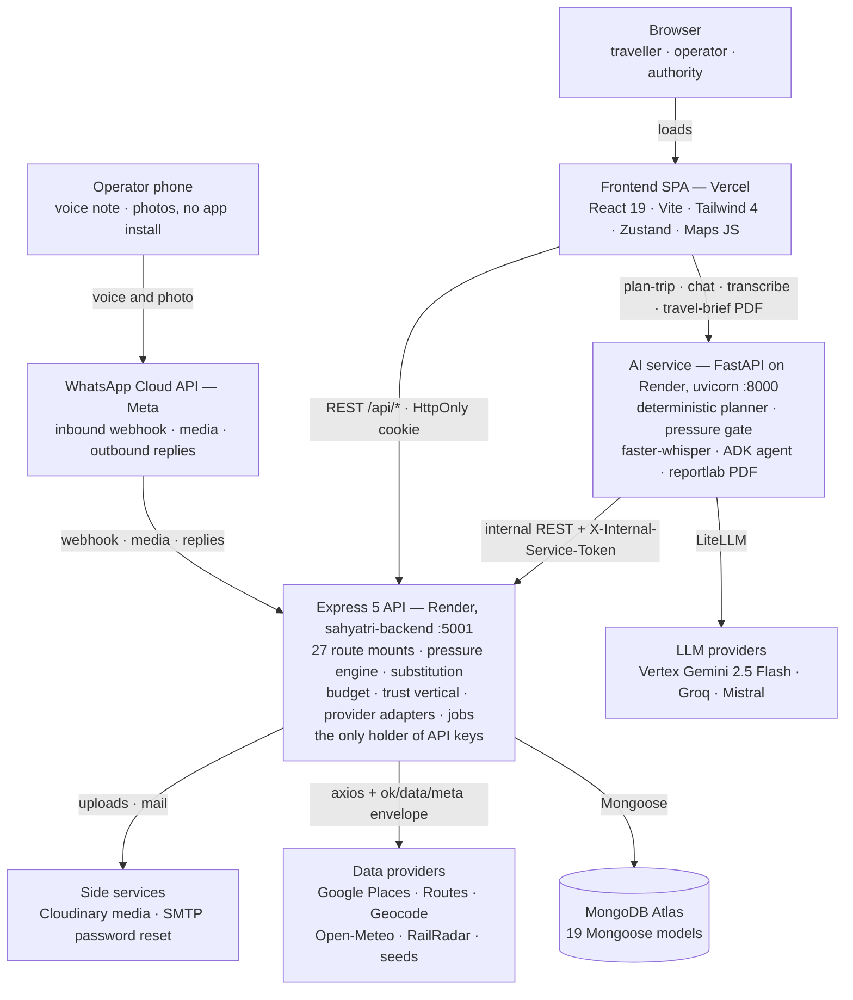
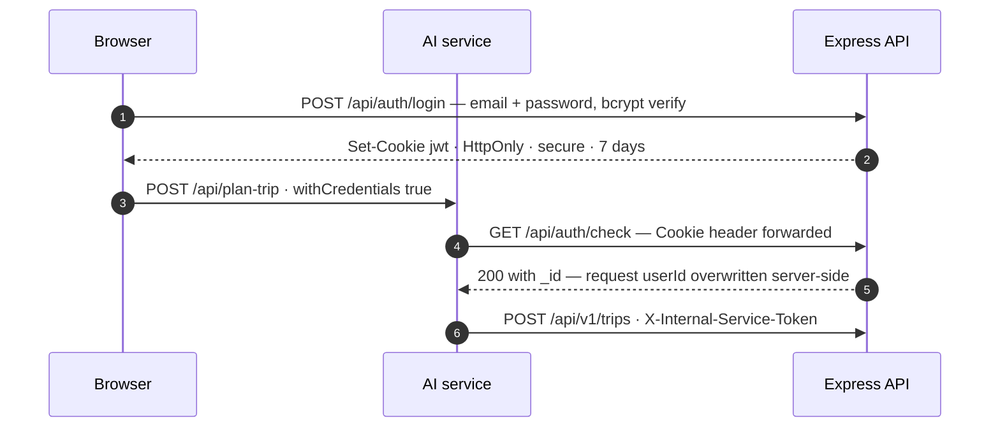
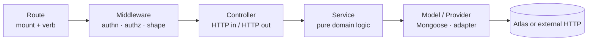
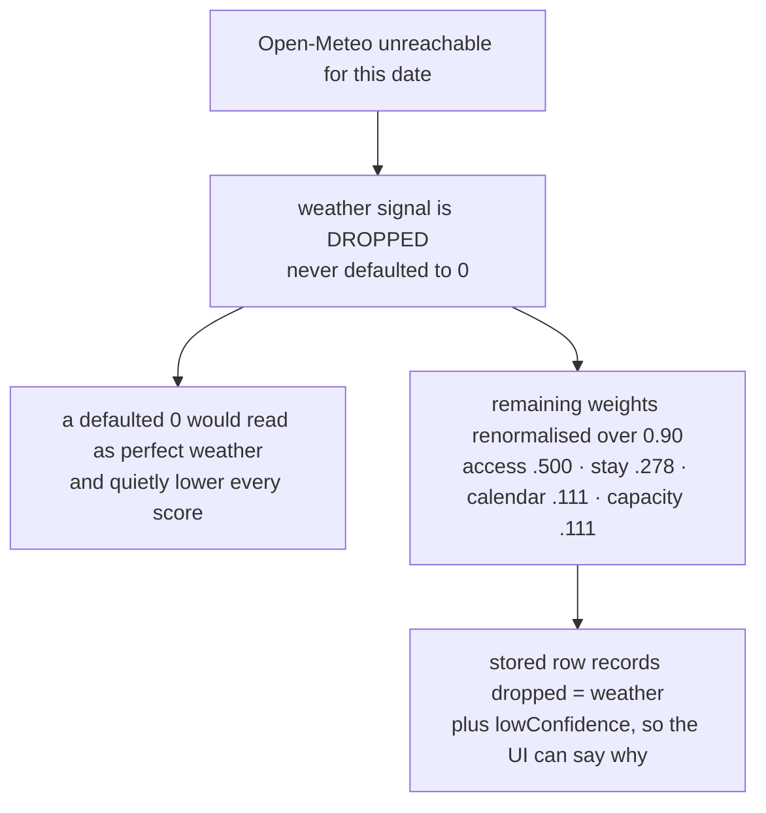
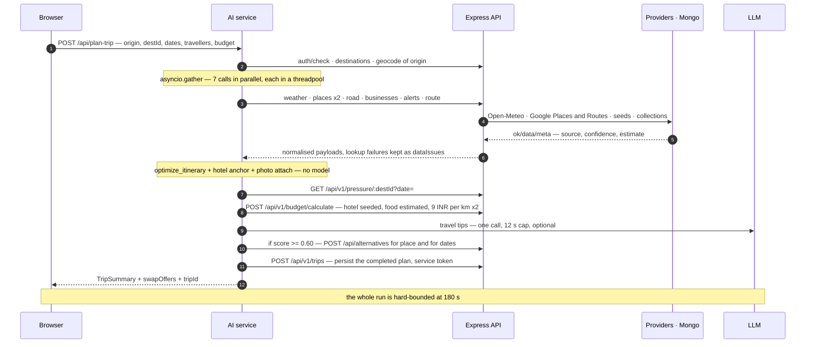
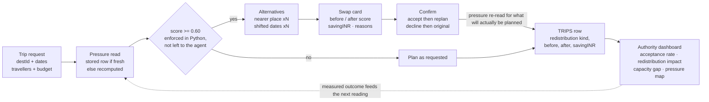
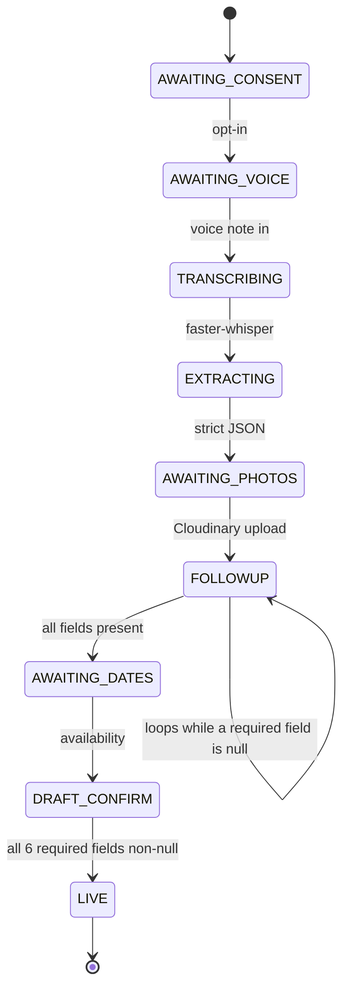

# Sahyatri

Sahyatri is a tourism redistribution platform built for **Smart India Hackathon problem statement SIH 26204**. It helps travellers find less-crowded destinations and dates *before* they book, instead of discovering the crowd after they arrive. The same data gives tourism operators, local gig workers, and government tourism authorities practical tools to manage demand.

The core idea is simple: every destination gets a **pressure score** for a given date. When the place a traveller wants is over pressure, the planner offers a calmer alternative (a nearby destination or a shifted date) and shows honestly what changes. The traveller decides. Declining the alternative is a normal outcome, not something the UI tries to talk anyone out of.

---

## Contents

1. [Who it's for](#who-its-for)
2. [Feature highlights](#feature-highlights)
3. [Architecture](#architecture)
4. [How the pressure engine works](#how-the-pressure-engine-works)
5. [How a trip gets planned](#how-a-trip-gets-planned)
6. [Tech stack](#tech-stack)
7. [Repository structure](#repository-structure)
8. [Prerequisites](#prerequisites)
9. [Local setup](#local-setup)
10. [Environment variables](#environment-variables)
11. [Frontend routes](#frontend-routes)
12. [Backend API overview](#backend-api-overview)
13. [AI service endpoints](#ai-service-endpoints)
14. [Background jobs and scripts](#background-jobs-and-scripts)
15. [Testing](#testing)
16. [Deployment](#deployment)
17. [Contributing](#contributing)
18. [Known issues](#known-issues)
19. [Further documentation](#further-documentation)
20. [In-depth architecture](#in-depth-architecture)

---

## Who it's for

Sahyatri is four connected experiences sharing one backend and one set of pressure data:

| Role | What they do |
| --- | --- |
| **Traveller** | Plans trips against real crowding data, gets offered calmer options, books verified local businesses, joins travel groups, verifies visits, reports safety concerns |
| **Operator** | Lists a homestay, guesthouse or restaurant; declares availability; runs flash offers; posts gigs to hire local staff; gets AI-generated marketing content and feedback insights; tracks revenue |
| **Worker** | Drivers, guides, cooks, cleaners and porters find gig work, build a verified profile, and get rated after every job, including being hired as a Group Travel "captain" |
| **Authority** | Watches destination pressure, capacity and redistribution on a live dashboard; moderates community-suggested places and complaints; can broadcast an emergency alert to every account |

---

## Feature highlights

- **Pressure-aware trip planning.** A live heatmap and a per-destination pressure score built from six signals, including a machine-learning demand forecast. Over-pressure plans get real alternative-destination and alternative-date suggestions, with the saving in rupees and the before/after pressure.
- **AI trip planning and chat.** The itinerary itself is built by deterministic Python code, not by a language model. An LLM is used only for language work: travel tips, trip-aware chat, the multilingual assistant (English, Telugu, Hindi), and a downloadable PDF travel brief.
- **Travel Types.** One shared vocabulary of travel styles (adventure, heritage, wildlife, spiritual, food, nightlife, and more) stored on each traveller's profile and reused for preferences, group matching and the AI agent.
- **Travel Education.** Authored destination guides (best time to visit, getting there, local culture, safety, packing, food, accessibility) with a draft → review → published workflow. A destination with no guide says so instead of inventing facts.
- **Group Travel.** Create or discover a group trip, get matched with compatible travellers with plain-English reasons, join or leave with guaranteed capacity limits, and request a verified local guide as the group's captain.
- **Business and booking tools.** Operator-declared availability, bookings, flash offers with automatic waitlist matching, and business search.
- **Proof of visit.** Operators show a six-digit code that changes every 90 seconds; travellers enter it to prove they were really there.
- **Worker/Gig marketplace.** Operators post gigs (guide, driver, cook, cleaner, porter); workers browse, accept, complete and rate them.
- **Trust and safety.** Community-suggested places (moderated by an authority before going live), verified alerts, emergency contacts, revocable shareable trip links, and one complaint queue for all account types.
- **Emergency broadcast alerts.** An authority can send an urgent platform-wide alert that emails every account and appears as a banner on every page.
- **WhatsApp onboarding.** An operator can register a business by sending a voice note on WhatsApp, in their own language. Speech-to-text uses Sarvam Saaras v4 (22 Indian languages plus English).
- **Authority dashboard.** Live pressure, capacity gaps, redistribution impact and offer acceptance rates, plus the moderation queues.
- **Low-bandwidth friendly.** Installable PWA, a data-saver mode, an offline request queue, and gzip/brotli compression on every API response.

---

## Architecture

Sahyatri is three independently deployed services backed by one MongoDB Atlas database.

| Service | Technology | Local URL | Responsibility |
| --- | --- | --- | --- |
| Frontend | React 19, Vite, Tailwind CSS 4, Zustand | `http://localhost:5173` | Browser app and all four role-based UIs |
| Backend | Node.js 20+, Express 5, Mongoose | `http://localhost:5001` | Auth, all data access, business logic, third-party providers, background jobs |
| AI service | Python 3.12, FastAPI, Google ADK, LiteLLM | `http://localhost:8000` | Trip planning, the pressure gate, chat, voice transcription, ML demand forecasts, PDF travel briefs |
| Database | MongoDB Atlas | — | All persistent data, accessed only through the backend |

```text
                   ┌───────────────────────────────┐
  Browser ────────▶│  Frontend (React SPA, Vercel)  │
                   └──────┬─────────────────┬───────┘
         REST + auth cookie│                 │ plan trip / chat / brief
                          ▼                 ▼
┌──────────────────────────────┐   ┌──────────────────────────────┐
│  Backend (Express, Render)   │◀──│  AI service (FastAPI, Render)│
│  - only holder of API keys   │   │  - deterministic planner     │
│  - only process that talks   │   │  - pressure gate (0.60)      │──▶ LLM via LiteLLM
│    to MongoDB                │──▶│  - demand ML model (XGBoost) │    (Vertex Gemini,
│  - pressure engine, jobs     │   │  - Sarvam speech-to-text     │     Groq, Mistral)
└──────┬───────────────┬───────┘   └──────────────────────────────┘
       │               │
       ▼               ▼
 MongoDB Atlas   Google Maps/Places/Routes, Open-Meteo, RailRadar,
                 Cloudinary, Brevo email, WhatsApp Cloud API
```

Key design rules:

- **The backend owns all data and all credentials.** The AI service never connects to MongoDB. Every AI tool calls the backend's normal REST API, so the AI can never see or change anything a signed-in user couldn't.
- **Two separate credentials between services.** The browser signs in against the backend (an HttpOnly JWT cookie, valid for 7 days). When the browser calls the AI service, the AI service forwards that cookie to `GET /api/auth/check` to learn *who* the user is. When the AI service writes data (such as trip drafts), it proves it is the trusted orchestrator with a shared `X-Internal-Service-Token` header.
- **The browser talks to two backends on purpose.** The SPA calls the Express API for everything data-shaped and calls the AI service directly for planning. The only secret in the browser is a Google Maps key restricted by HTTP referrer.
- **Failures degrade instead of crashing.** Provider adapters return an `{ ok, data, meta }` envelope and never throw. If one lookup fails (for example, the Places quota runs out), the plan still completes and lists what's missing.

---

## How the pressure engine works

A destination's pressure for a date is a weighted blend of six signals, each scaled to 0–1. The weights live in `backend/src/config/runtime_config.json` (currently **formula version 3**):

| Signal | Weight | What it measures | Source |
| --- | ---: | --- | --- |
| `demand` | 0.3059 | Forecast visitor demand vs. that destination's normal level for the month | XGBoost model served by the AI service |
| `stay` | 0.2136 | Accommodation scarcity: unavailable share and price vs. baseline | Seeded hotel prices adjusted by the calendar |
| `access` | 0.2135 | How full the trains and roads into the destination are | RailRadar waitlists plus road timetable frequency |
| `calendar` | 0.1068 | Festivals, holidays and weekends | Seeded state calendar |
| `weather` | 0.1068 | How pleasant the weather is (pleasant weather attracts more visitors) | Open-Meteo forecast |
| `capacity` | 0.0534 | How crowded the destination usually gets | Destination's `capacityPrior` (static) |

The blended value goes through a fixed logistic calibration, so the final score stays between 0 and 1 and keeps the same ranking order. Levels are split at 0.25 / 0.50 / 0.75.

Rules that make the score trustworthy:

- **Missing signals are dropped, never set to zero.** If weather data is unavailable, the weather weight is removed and the remaining weights are rescaled. A zero would read as "perfect weather" and quietly lower every score. Each stored score records which signals were `dropped` and is marked `lowConfidence` if more than 40% of the weight is missing.
- **No fake road data.** No road provider returns seat availability, only timetable frequency. When that happens the row is marked `degraded: ["road"]` and the access signal falls back to the static prior, rather than pretending to be live occupancy.
- **Stale formulas are recomputed.** A stored score is reused only if it is less than 24 hours old *and* was computed with the current formula version. Otherwise it is recomputed live (with a 4-second budget), falling back to the newest stored row if that times out.
- **The gate is code, not a prompt.** The AI service offers alternatives when a score is **≥ 0.60** (`PRESSURE_GATE` in `ai-service/app/main.py`). No model can skip this check. A missing score is never treated as "low".

> `runtime_config.json` exists in both `backend/src/config/` and `ai-service/app/config/`, because each Render service deploys only its own folder. If you change the weights, update both copies.

---

## How a trip gets planned

1. The traveller submits origin, destination, dates, number of travellers and budget. The AI service validates the input first (1–20 travellers, budget > 0, real dates, end ≥ start) before spending any API calls.
2. The AI service identifies the user through the backend, then runs seven lookups in parallel through the backend: weather, two Places searches, road info, businesses, alerts and route.
3. It builds the itinerary in plain Python (no LLM): orders stops, anchors a hotel, and attaches place photos. If Places returns nothing, it falls back to a curated list of named stops, or an empty day, never invented places.
4. It reads the destination's pressure and calculates the budget (hotel, food, and local transport priced from the actual distance between stops).
5. It asks the LLM for travel tips (one call, capped at 12 seconds; if it fails, the plan simply has no tips).
6. If pressure is ≥ 0.60, it asks the backend for alternative destinations and dates and shows a swap card with before/after pressure and the rupee saving.
7. The plan is saved as a trip. When the traveller accepts or declines a swap, the pressure is re-read for what will actually be planned, and the decision is recorded. The authority dashboard reports these outcomes.

The whole request has a hard limit of **180 seconds**.

---

## Tech stack

| Area | Tools |
| --- | --- |
| Frontend | React 19, Vite 8, Tailwind CSS 4, Zustand 5, React Router 7, Axios (with retry), Lucide icons, vite-plugin-pwa, Google Maps JavaScript API |
| Backend | Express 5, Mongoose 8, JSON Web Tokens, bcryptjs, express-rate-limit, compression, multer, Cloudinary SDK, Axios |
| AI service | FastAPI, Uvicorn, Google ADK, LiteLLM, google-genai, XGBoost + joblib, NumPy, ReportLab, Requests |
| Speech-to-text | Sarvam Saaras v4 (WhatsApp onboarding), Groq Whisper large-v3 (operator content generator voice input) |
| Data | MongoDB Atlas; 200 destination seed files |
| Testing | Jest + mongodb-memory-server (backend), Python `unittest` (AI service), ESLint (frontend) |
| Hosting | Render (backend, AI service), Vercel (frontend) |

---

## Repository structure

```text
SIH_26204/
├── backend/                       Express 5 API (Node ≥ 20, ES modules)
│   ├── src/
│   │   ├── index.js               Entry point: middleware, CORS allowlist, /health, route mounts, alert scheduler
│   │   ├── routes/                One router per API group
│   │   ├── controllers/           Request/response handling only
│   │   ├── services/              Domain logic: pressure, substitution, onboarding, waitlist,
│   │   │                          proof of visit, community, feedback, gigs, groups, revenue, …
│   │   ├── providers/             External API adapters (Google Maps, geocode, Open-Meteo, RailRadar,
│   │   │                          road transport, fares, stay estimates, demand ML)
│   │   ├── models/                Mongoose schemas
│   │   ├── middleware/            Auth, role checks, service-token auth, rate limits, validation
│   │   ├── jobs/                  Alert polling (runs in-process), pressure precompute and offer expiry (run by hand)
│   │   ├── lib/                   DB connection, JWT, Cloudinary, mailer and email templates, caching, helpers
│   │   ├── config/                runtime_config.json (pressure weights and calibration)
│   │   └── seeds/                 200 destination JSON files, businesses, fares, calendar, pressure CSVs, seed scripts
│   ├── test-fixtures/             Road-frequency data (read at runtime by the road provider)
│   ├── budget.http                Manual budget API requests (VS Code REST Client)
│   └── *.postman_collection.json  Postman collections (budget, trust vertical)
│
├── ai-service/                    FastAPI service (Python 3.12)
│   ├── app/
│   │   ├── main.py                Entry point: planner, pressure gate, chat, onboarding, travel brief
│   │   ├── agents/                Google ADK agents (travel agent, multimodal agent)
│   │   ├── tools/                 Agent tools; every one calls the backend REST API
│   │   ├── services/              Backend client, trip drafts, demand predictor
│   │   ├── onboarding/            Speech-to-text (Sarvam) and extraction prompt, with unit tests
│   │   ├── models/                model_demand_causal.pkl (XGBoost demand model)
│   │   ├── config/                Model feature order and runtime config
│   │   └── pdf_builder.py         ReportLab travel-brief PDF
│   └── test_agent.py              Manual end-to-end agent check (needs real model credentials)
│
├── frontend/                      React 19 + Vite single-page app (PWA)
│   ├── src/
│   │   ├── App.jsx                Routes and role guards
│   │   ├── components/            Feature folders: map, planner, pressure, swap, trust, operator,
│   │   │                          worker, authority, groups, profile, auth, ui, …
│   │   ├── store/                 Zustand stores, one per feature area
│   │   ├── lib/                   API client, Google Maps loader, labels, offline queue, caching helpers
│   │   └── pages/                 Landing page and map page
│   ├── public/                    Logo, India map, PWA icons
│   └── vercel.json                Vercel build settings and SPA rewrite
│
├── scripts/                       Distance calibration, git-hook setup
├── .githooks/commit-msg           Conventional Commits check
├── render.yaml                    Render blueprint for the backend and AI service
├── API_CONTRACTS.md               API contracts between team members and services
└── COMMIT_CONVENTION.md           Commit message rules
```

---

## Prerequisites

- **Node.js 20 or later** and npm
- **Python 3.12** (matches the deployed runtime)
- **A MongoDB database**, such as a free MongoDB Atlas cluster
- **API keys only for the features you want to try.** Most features degrade gracefully without a key (for example, emails are printed to the console when no email key is set).
- **An LLM provider** for the AI features: Google Vertex AI (default), Groq, or Mistral

---

## Local setup

Each service can be set up and run on its own. The commands below use PowerShell; on macOS/Linux use `cp` instead of `Copy-Item` and `source .venv/bin/activate` to activate Python.

### 1. Backend

```powershell
cd backend
npm install
Copy-Item .env.example .env
```

In `backend/.env`, set at least `MONGODB_URI`, `JWT_SECRET` and `CLIENT_URL`. Add provider keys only for the features you're testing (see [Environment variables](#environment-variables)).

Start the API:

```powershell
npm run dev
```

Health check: `http://localhost:5001/health`

**Loading seed data (development database only).** Destinations are read straight from the JSON files in `src/seeds/destinations/`, and pressure scores are computed on demand, so the app works without seeding. To load businesses, availability, calendar and pressure history into MongoDB:

```powershell
node src/seeds/import_pressure_v3.js --dry-run
node src/seeds/import_pressure_v3.js --yes
npm run seed
```

> ⚠️ These scripts **delete and replace** data: `import_pressure_v3.js --yes` clears the whole `destination_pressures` collection, and `npm run seed` replaces seeded destinations, seeded businesses and business-declared availability. Never point them at a production database. Also see [Known issues](#known-issues): `npm run seed` currently needs a file that is not in the repository.

### 2. AI service

```powershell
cd ai-service
py -3.12 -m venv .venv
.\.venv\Scripts\Activate.ps1
pip install -r requirements.txt
Copy-Item .env.example .env
```

In `ai-service/.env`, set:

- `BACKEND_URL` (default `http://localhost:5001`)
- `INTERNAL_SERVICE_TOKEN`: **must exactly match** the backend's value
- `CLIENT_URL`: the frontend origin
- `MODEL` plus credentials for that provider:
  - Vertex AI (default, `vertex_ai/gemini-2.5-flash`): run `gcloud auth application-default login`, or put a service-account file in `.gcp/` (gitignored) and set `GOOGLE_APPLICATION_CREDENTIALS`, `GOOGLE_CLOUD_PROJECT` and `GOOGLE_CLOUD_LOCATION`
  - Groq: set `MODEL=groq/<model>` and add `GROQ_API_KEY`
  - Mistral: set `MODEL=mistral/<model>` and add `MISTRAL_API_KEY`
- `SARVAM_API_KEY` if you want voice onboarding

Start the service:

```powershell
uvicorn app.main:app --reload --port 8000
```

Health check: `http://localhost:8000/health`

### 3. Frontend

```powershell
cd frontend
npm install
Copy-Item .env.example .env
npm run dev
```

Open `http://localhost:5173`.

### Recommended start order

Backend → AI service → frontend. The frontend and AI service fall back to localhost defaults, so you can run just the pieces you're working on.

---

## Environment variables

Each service has its own `.env` file. They are never shared and never committed. The `.env.example` in each folder is the starting template.

### Backend (`backend/.env`)

| Variable | Required | Purpose |
| --- | --- | --- |
| `MONGODB_URI` | Yes | MongoDB connection string |
| `JWT_SECRET` | Yes | Signs the login cookie |
| `PORT` | No | API port (`.env.example` uses `5001`; code default is `5000`) |
| `CLIENT_URL` | Yes | Allowed frontend origin(s), comma-separated |
| `NODE_ENV` | Yes | `development` locally, `production` when deployed (controls secure cookies) |
| `INTERNAL_SERVICE_TOKEN` | For AI features | Shared secret with the AI service; must match exactly |
| `AI_SERVICE_URL` | For ML demand | AI service base URL, e.g. `http://localhost:8000` |
| `EXTRACT_SERVICE_URL` | For WhatsApp onboarding | Full URL of the AI service's `/onboarding/extract` |
| `TRANSCRIBE_SERVICE_URL` | For WhatsApp onboarding | Full URL of the AI service's `/onboarding/transcribe` |
| `GOOGLE_MAPS_API_KEY` | For maps data | Places, Routes and Geocoding (server-side) |
| `GOOGLE_GEOCODE_API_KEY` | No | Separate geocoding key; falls back to `GOOGLE_MAPS_API_KEY` |
| `RAILRADAR_API_KEY` | For train data | Train seat availability |
| `CLOUDINARY_CLOUD_NAME`, `CLOUDINARY_API_KEY`, `CLOUDINARY_API_SECRET` | For uploads | Profile pictures, community and onboarding photos |
| `BREVO_API_KEY` | No | Sends email; when unset, emails are printed to the console |
| `MAIL_FROM` | With Brevo | The verified sender address |
| `WHATSAPP_TOKEN`, `WHATSAPP_PHONE_NUMBER_ID`, `WHATSAPP_WEBHOOK_VERIFY_TOKEN` | For WhatsApp | Meta WhatsApp Cloud API |
| `GROQ_API_KEY` | For content generator | Marketing content and voice input for operators |
| `MISTRAL_API_KEY` | No | Fallback for the content generator if Groq fails |
| `PRESSURE_MAP_CONCURRENCY` | No | Parallel pressure computations for the heatmap (default `10`) |

### AI service (`ai-service/.env`)

| Variable | Required | Purpose |
| --- | --- | --- |
| `MODEL` | Yes | LiteLLM model id in `provider/model` form (default `vertex_ai/gemini-2.5-flash`) |
| `BACKEND_URL` | Yes | Backend base URL (default `http://localhost:5001`) |
| `INTERNAL_SERVICE_TOKEN` | Yes | Must match the backend's value |
| `CLIENT_URL` | Yes | Allowed frontend origin(s), same value as the backend |
| `GOOGLE_CLOUD_PROJECT`, `GOOGLE_CLOUD_LOCATION`, `GOOGLE_APPLICATION_CREDENTIALS` | For Vertex AI | Google Cloud credentials |
| `GROQ_API_KEY` / `MISTRAL_API_KEY` | For those models | Read automatically by LiteLLM when `MODEL` uses that provider |
| `SARVAM_API_KEY` | For voice onboarding | Sarvam speech-to-text |

### Frontend (`frontend/.env`)

These values are built into the app at build time.

| Variable | Required | Purpose |
| --- | --- | --- |
| `VITE_API_URL` | Yes | Backend API base, e.g. `http://localhost:5001/api` |
| `VITE_AI_SERVICE_URL` | Yes | AI service base, e.g. `http://localhost:8000` |
| `VITE_GOOGLE_MAPS_API_KEY` | For maps | Browser Maps key; **restrict it by HTTP referrer** in Google Cloud Console |
| `VITE_WHATSAPP_ONBOARDING_NUMBER` | No | WhatsApp number shown to operators for voice onboarding |

---

## Frontend routes

| Access | Routes |
| --- | --- |
| **Public** | `/` (landing), `/signin`, `/signup`, `/forgot-password`, `/reset-password`, `/explore` (pressure heatmap), `/explore/:destId`, `/businesses`, `/alerts`, `/trip/share/:token` |
| **Any signed-in user** | `/home` (trip planner), `/multimodal-agent`, `/map`, `/trips`, `/swap`, `/trip-confirmation`, `/visits`, `/community`, `/forum`, `/services`, `/notifications`, `/offers`, `/safety`, `/profile`, `/travel-together`, `/travel-together/groups/:id` |
| **Operator** | `/operator`, `/register-business`, `/hire-people`, `/operator/waitlist`, `/operator/analytics`, `/operator/content-generator`, `/operator/revenue`, `/operator/complaints` |
| **Worker** | `/worker`, `/worker/jobs`, `/worker/complaints` |
| **Authority** | `/authority`, `/authority/complaints`, `/authority/alerts` |
| **Old URLs (redirect)** | `/login`, `/pressure`, `/planner`, `/map-preview`, `/verify-email`, `/operator/post-gig` |

`/visits` shows operators their rotating code and everyone else the code-entry form. `/community` shows authorities the moderation queue and everyone else the submission form. Role checks in the browser are for convenience only; the backend enforces every permission itself.

---

## Backend API overview

All routes live under `/api`. The full list is mounted in `backend/src/index.js`.

| Area | Base paths |
| --- | --- |
| Auth and users | `/api/auth` (signup, login, logout, check, password reset/change, profile; rate-limited), `/api/v1/users` |
| Planning inputs | `/api/v1/pressure`, `/api/alternatives`, `/api/v1/budget`, `/api/destinations`, `/api/geocode` |
| Provider passthroughs | `/api/weather`, `/api/trains`, `/api/places` (includes a photo proxy that keeps the key server-side), `/api/routes`, `/api/fare`, `/api/road` |
| Trips and analytics | `/api/v1/trips`, `/api/v1/analytics`, `/api/v1/dashboard` |
| Trust and safety | `/api/v1/visits`, `/api/community`, `/api/v1/offers`, `/api/v1/waitlist`, `/api/v1/alerts`, `/api/v1/businesses`, `/api/v1/bookings`, `/api/v1/safety` |
| Operator tools | `/api/v1/content`, `/api/v1/feedback`, `/api/v1/revenue` |
| Workers and groups | `/api/v1/workers`, `/api/v1/gigs`, `/api/v1/operators`, `/api/v1/group-trips`, `/api/v1/travel-types` |
| Travel Education | `/api/v1/destinations` (separate from the file-based `/api/destinations` list) |
| Messaging | `/api/webhook/whatsapp`, `/api/internal/onboarding`, `/api/v1/broadcast-alerts` |
| Health | `GET /health` (does not depend on MongoDB) |

---

## AI service endpoints

| Endpoint | Purpose |
| --- | --- |
| `GET /health` | Health check for Render |
| `POST /api/plan-trip` | Full trip plan, pressure gate, swap offers, saves a draft trip (180 s limit) |
| `POST /api/plan-trip/confirm` | Accept or decline a swap offer and re-plan |
| `POST /api/v1/pressure/predict-demand` | ML demand forecast used by the backend's pressure engine |
| `POST /onboarding/transcribe` | Voice note → text (Sarvam) |
| `POST /onboarding/extract` | Transcript → structured business/worker details |
| `POST /internal/ai/recommendation` | Short map-overlay recommendation (10 s limit) |
| `POST /internal/ai/chat` | Trip-aware "Ask AI" chat (15 s limit, 20 requests per 10 minutes) |
| `GET /api/multimodal/meta` | Supported languages and roles |
| `POST /api/multimodal/transcribe` | Voice input for the multilingual assistant |
| `POST /api/multimodal/chat` | Multilingual assistant turn (English, Telugu, Hindi) |
| `POST /internal/ai/travel-brief` | Structured travel brief |
| `POST /internal/travel-brief/pdf` | The same brief as a PDF file |

---

## Background jobs and scripts

| Job or script | How it runs | What it does |
| --- | --- | --- |
| Alert polling (`jobs/pollAlerts.job.js`) | Automatically on startup, then every 6 hours | Turns Open-Meteo data into weather advisories |
| Pressure precompute (`jobs/precomputePressure.job.js`) | `node src/jobs/precomputePressure.job.js` (from `backend/`) | Fills pressure scores ahead of time plus 30 days of history, so the heatmap and trends load from cache |
| Offer expiry (`jobs/expireOffers.job.js`) | `node src/jobs/expireOffers.job.js` (from `backend/`) | Marks expired flash offers (alongside MongoDB's automatic cleanup) |
| Seed validation | `node src/seeds/validateSeeds.js` (from `backend/`) | Checks the seed files are well-formed |
| Distance calibration | `node scripts/calibrateDistance.js` (from the repo root; needs `backend/` dependencies and a database) | Writes `build/distance-histogram.json`, which tunes how far alternative destinations may be |

---

## Testing

**Backend** (Jest; uses an in-memory MongoDB where a database is needed):

```powershell
cd backend
npm test
```

**AI service** (Python `unittest`, run from `ai-service/` with the virtual environment active):

```powershell
python -m unittest app.onboarding.test_extraction_prompt app.onboarding.test_transcribe_sarvam
```

`python test_agent.py` runs the travel agent end to end. It calls a real model, so it needs working credentials.

**Frontend:**

```powershell
cd frontend
npm run lint
npm run build
```

**Manual API testing:** open `backend/budget.http` in VS Code with the REST Client extension, or import the Postman collections in `backend/`.

---

## Deployment

The backend and AI service deploy to **Render** using `render.yaml`. The frontend deploys to **Vercel** (settings in `frontend/vercel.json`).

Because the three services reference each other's URLs, deploy in this order:

1. **Backend** on Render. Set its secrets in the Render dashboard (`render.yaml` lists which variables must exist but never holds their values). Also add any optional keys you need that aren't listed there, such as `BREVO_API_KEY`, `MAIL_FROM`, `WHATSAPP_*`, `GROQ_API_KEY` or `MISTRAL_API_KEY`.
2. **AI service** on Render, with `BACKEND_URL` pointing at the deployed backend.
3. **Frontend** on Vercel, with `VITE_API_URL` and `VITE_AI_SERVICE_URL` pointing at the two deployed services.
4. Go back and set `CLIENT_URL` on both the backend and the AI service to the real Vercel URL, and set the backend's `AI_SERVICE_URL`, `EXTRACT_SERVICE_URL` and `TRANSCRIBE_SERVICE_URL`.

Before going live, check:

1. **`NODE_ENV=production` on the backend.** This controls the cookie's `secure`/`sameSite` settings. If it's wrong, login appears to succeed and every following request returns 401.
2. **`CLIENT_URL` on both** the backend and the AI service includes the deployed frontend's exact origin.
3. **`INTERNAL_SERVICE_TOKEN` is identical** on the backend and the AI service. Otherwise every AI-to-backend call (trip drafts, group tools, preferences) fails.
4. **`AI_SERVICE_URL`, `EXTRACT_SERVICE_URL` and `TRANSCRIBE_SERVICE_URL`** point at the deployed AI service, not `localhost`. Otherwise ML demand forecasts and WhatsApp onboarding silently stop working.
5. **The browser Maps key is restricted by HTTP referrer** to your domain.
6. **For WhatsApp**, set the Meta webhook to `https://<backend-url>/api/webhook/whatsapp` using your `WHATSAPP_WEBHOOK_VERIFY_TOKEN`.
7. **No secrets are committed.** All credentials live in the hosting dashboards.

---

## Contributing

- **Commit messages follow [Conventional Commits](https://www.conventionalcommits.org/)** (`type(scope): description`, e.g. `feat(pressure): add demand signal`). Allowed types: `feat`, `fix`, `refactor`, `test`, `docs`, `ci`, `build`, `chore`, `perf`, `style`, `revert`. See `COMMIT_CONVENTION.md`.
- **Install the commit-message hook once per clone** (run from the repo root):

  ```powershell
  .\scripts\setup-hooks.bat
  ```

  On macOS/Linux, run `sh scripts/setup-hooks.sh`. Merge, squash and fixup commits are allowed through automatically.
- **Run the tests** for any service you change before opening a pull request.
- **Never commit `.env` files or credentials.** `.env`, `.gcp/` and `build/` are gitignored.

---

## Known issues

- **`npm run seed` fails on a fresh clone.** `seedDatabase.js` reads `backend/src/seeds/pressure_history.json`, which is gitignored and not in the repository. Pressure history now comes from `pressure_history_v3.csv` via `import_pressure_v3.js`.
- **`npm run prepare-hooks` (in `backend/`) sets the wrong hooks path** (`../.githooks`). Use the `scripts/setup-hooks` scripts instead.
- **Some data has no writer yet.** The `destination_demand` and `business_availability` inputs for the capacity-gap metric are not populated, so the dashboard shows `null` for those metrics instead of a made-up number.
- **The [in-depth architecture](#in-depth-architecture) section predates formula version 3.** It describes the older five-signal pressure formula; the table above reflects the current code.

---

## Further documentation

- [In-depth architecture](#in-depth-architecture): design, diagrams and trade-offs
- [API contracts](API_CONTRACTS.md): endpoints that cross team and service boundaries
- [Commit convention](COMMIT_CONVENTION.md): commit message rules

---

## In-depth architecture

**SIH 26204** · branch `feat/multimodal-tourism-agent` · HEAD `2c8e6ed`

A three-service tourism platform whose single product rule is **redistribution**: measure
crowd pressure on a destination for a date, and when it crosses **0.60**, offer the
traveller a nearer place or a shifted date *before* the plan is built.

| | |
|---|---|
| Deployables | 3 + MongoDB Atlas |
| Express route mounts | 27 |
| Mongoose models | 19 |
| Pressure signals | 5, weighted and locked |
| Gate threshold | `PRESSURE_GATE = 0.60` |

> Constants quoted throughout this document — the 0.60 gate, the 180 s ceiling, the
> 0.45/0.25/0.10/0.10/0.10 weights, the 90 s proof-of-visit window, the 20/3/7 waitlist
> limits, ₹9/km, the ₹3,500 nightly baseline — are read from source, not from documentation.
> `PROJECT_OVERVIEW.md` describes only the original auth + budget slice and predates most
> of what is below.

---

### Architecture contents

1. [The system at a glance](#1-the-system-at-a-glance)
2. [Deployment topology](#2-deployment-topology)
3. [Identity across two backends](#3-identity-across-two-backends)
4. [Frontend architecture](#4-frontend-architecture)
5. [Express backend](#5-express-backend)
6. [The pressure engine](#6-the-pressure-engine)
7. [AI service](#7-ai-service)
8. [A plan-trip request, end to end](#8-a-plan-trip-request-end-to-end)
9. [The redistribution loop](#9-the-redistribution-loop)
10. [The trust vertical](#10-the-trust-vertical)
11. [WhatsApp voice onboarding](#11-whatsapp-voice-onboarding)
12. [Data model](#12-data-model)
13. [Jobs, caches and limits](#13-jobs-caches-and-limits)
14. [Repository map](#14-repository-map)

---

### 1. The system at a glance

Three independently deployed processes, one database, and a deliberately thin set of
external providers. Nothing is a monolith by accident: the Express API owns all
persistence and all provider credentials, the FastAPI service owns orchestration and every
model call, and the browser holds no secret except a Maps JS key restricted by HTTP
referrer.



Two arrows leave the browser, not one: the SPA talks to Express for everything CRUD-shaped
and to the AI service directly for planning. Every credential-bearing outbound call
originates in Express — the AI service holds only model keys and a shared service token.

#### Why three services and not one

- **Language fit.** The planner needs `faster-whisper`, the Google ADK, LiteLLM and
  reportlab — a Python runtime. The rest of the product is CRUD, aggregation and JWT,
  which Express does with less ceremony.
- **Blast radius.** A hung model call or an exhausted Places quota degrades planning only.
  The trust vertical, the authority dashboard and auth stay up, because they never
  traverse the AI service.
- **Credential containment.** RailRadar, Google Maps, Cloudinary and SMTP keys exist in
  exactly one process. The AI service reaches them only through Express endpoints that
  already normalise and label the responses.
- **Scaling shape.** Planning is bursty and CPU-heavy (Whisper transcription runs in a
  threadpool); the API is steady and I/O-bound. Separate Render services scale on separate
  curves.

---

### 2. Deployment topology

`render.yaml` declares both server-side services as Render web services with health checks;
the SPA ships to Vercel (`frontend/vercel.json`). Every secret is marked `sync: false` —
the file declares which variables must exist, never their values.

| Service | Runtime | Start command | Health | Local port |
|---|---|---|---|---|
| `sahyatri-backend` | Node (ESM) | `npm start` → `src/index.js` | `GET /health` | 5001 |
| `sahyatri-ai-service` | Python 3.12.10 | `uvicorn app.main:app` | `GET /health` | 8000 |
| `frontend` | Vite static build | `vite build` → Vercel CDN | — | 5173 |
| MongoDB Atlas | Managed | `mongoose.connect(MONGODB_URI)` | — | — |

Both `/health` routes are deliberately independent of Mongo, so a database blip does not
take the service out of the load balancer.

#### Environment, by owner

| Variables | Owner | Notes |
|---|---|---|
| `MONGODB_URI`, `JWT_SECRET` | backend | JWT signs the auth cookie; nothing else reads it |
| `CLIENT_URL` | backend + AI service | Comma-separated origin allowlist, parsed identically by Express CORS and FastAPI `CORSMiddleware`, so the two can never disagree about who may call them |
| `INTERNAL_SERVICE_TOKEN` | backend + AI service | Compared with `crypto.timingSafeEqual`, never `===` |
| `GOOGLE_MAPS_API_KEY`, `RAILRADAR_API_KEY`, `AMADEUS_*` | backend | The provider adapters are the sole callers |
| `CLOUDINARY_*`, `SMTP_*`, `MAIL_FROM` | backend | With SMTP unset the mailer logs the reset link to stdout, keeping the whole recovery flow testable offline |
| `WHATSAPP_TOKEN`, `WHATSAPP_PHONE_NUMBER_ID`, `WHATSAPP_WEBHOOK_VERIFY_TOKEN` | backend | Webhook verification, media fetch, replies |
| `BACKEND_URL` | AI service | Base URL for internal REST; defaults to `http://localhost:5001` |
| `MODEL`, `GROQ_*`, `MISTRAL_*`, `GOOGLE_API_KEY`, `GOOGLE_CLOUD_*` | AI service | A LiteLLM model id (`provider/model`), not a bare model name |
| `VITE_API_URL`, `VITE_AI_SERVICE_URL` | frontend | Baked in at build time — two base URLs, because the SPA genuinely has two backends |
| `VITE_GOOGLE_MAPS_API_KEY` | frontend | Public by necessity (Maps JavaScript API); must be referrer-restricted in the Cloud Console. The one key that reaches the browser. |

> **Deployment trap, documented in code.** The auth cookie is `SameSite`-scoped and
> `secure` unless `NODE_ENV === "development"`. Frontend and backend sit on different
> origins in production, so if `NODE_ENV` is not `production` on Render, login succeeds and
> every subsequent request comes back 401 — a silent auth loop rather than an error.

---

### 3. Identity across two backends

The hardest boundary in the system is not data — it is session. The browser authenticates
against Express, then calls the AI service, which must know who the caller is without ever
minting or verifying a token itself.



Two distinct credentials, never interchanged. The forwarded cookie answers *who is this
traveller*; the service token answers *is this call coming from our own orchestrator*. A
trip draft created by the AI service is therefore attributable to a real user **and**
unreachable from an arbitrary client.

- **Client-supplied `userId` is never trusted.** When `/api/auth/check` resolves an id,
  `plan_trip` replaces the request `userId` with it; only an unauthenticated caller keeps
  `"guest"`.
- **Draft ownership is re-checked on confirm.** `confirm_trip` returns 403 when an
  authenticated user id does not match the draft owner, so a leaked `tripDraftId` alone
  buys nothing.
- **The offered set is authoritative.** `match_offer` accepts only a `destId` or
  `startDate` that appears in the stored draft; savings and pressure figures come from the
  draft, never from the client claim.
- **`protectRouteOrService`** tries the service token first and falls back to normal cookie
  auth, so `/api/internal/onboarding/upload` and `/api/v1/users/:id/preferences` serve both
  machines and people through one handler.

---

### 4. Frontend architecture

A single Vite SPA with role-branched routing. State is nine small Zustand stores rather
than one global store — each owns the endpoints for a single surface, so a failing section
degrades alone.

#### Two API clients, on purpose

`src/lib/api.js` is an axios instance pointed at Express with `withCredentials`, used by
eight of the nine stores. `usePlannerStore` builds its own client against
`VITE_AI_SERVICE_URL` — the AI service is a peer, not something proxied through `/api`, and
pretending otherwise would hide a real network boundary from anyone reading the code.

| Store | Backs | Talks to |
|---|---|---|
| `useAuthStore` | Session, signup/login, profile, role home | `/api/auth/*` |
| `usePlannerStore` | Trip planner, plan results, chat, travel brief | AI service |
| `usePressureStore` | Explore heatmap, full component rows | `/v1/pressure/map` |
| `useSubstitutionStore` | Swap page candidates | `/api/alternatives` |
| `useTripsStore` | My Trips history and detail | `/v1/trips` |
| `useTrustStore` | Proof-of-visit, community, offers, alerts, safety, businesses | 7 endpoint groups |
| `useOperatorStore` | Business registration, waitlist, flash offers, rotating code, hiring | `/v1/businesses` · `/v1/offers` · `/v1/waitlist` · `/v1/visits` |
| `useAuthorityDashboardStore` | Four dashboard panels, each fetched and failed independently | `/v1/dashboard/*` |
| `useDestinationsStore` | Destination catalogue, request-deduplicated and cached in memory | `/api/destinations` |

#### Routing and role gates

Guards live in `components/shell/Guards.jsx`: `RequireAuth` (standard page shell),
`RequireAuthBare` (full-bleed canvases like the map and swap flow) and `RequireRole`. Two
routes branch on role at the same URL — `/visits` shows an operator the live rotating code
and everyone else the entry form; `/community` shows an authority the moderation queue and
a traveller the submission form.

> Role gates in the SPA are convenience, not security. `/community/submissions/queued` and
> the review endpoint reject a non-authority server-side regardless of what the client
> renders; the trips summary route is wrapped in `requireRole("authority")`.

- **Public:** `/`, `/signin`, `/signup`, `/forgot-password`, `/reset-password`, `/explore`,
  `/explore/:destId`, `/businesses`, `/alerts`
- **Authenticated:** `/home`, `/multimodal-agent`, `/map`, `/trips`, `/swap`,
  `/trip-confirmation`, `/visits`, `/community`, `/services`, `/notifications`, `/offers`,
  `/safety`, `/profile`
- **Operator:** `/operator`, `/register-business`, `/hire-people`, `/operator/waitlist`
- **Authority:** `/authority`
- **Legacy redirects:** `/login`, `/pressure`, `/planner`, `/map-preview`, `/verify-email`

#### Map surface

The densest component family in the repo: `EverythingMap.jsx` composes eleven layers and
panels — destination markers, category markers, current location, places, pressure
heatmap, route polyline, stop picker, travel-mode selector, route details, trip summary and
the AI assistant overlay. `lib/googleMapsLoader.js` injects the Maps JS SDK exactly once
(with `places` and `visualization`) and memoises the promise, so remounting a layer never
re-injects the script tag.

---

### 5. Express backend

`backend/src/index.js` is deliberately boring: load `backend/.env` by absolute path (so the
server starts identically from repo root or from `backend/`), install JSON + cookie + CORS
middleware, expose a Mongo-independent `/health`, mount 27 route groups, then connect to
Mongo and start the alert scheduler.



Worked example — a traveller claims a flash offer:

`/v1/offers POST /:id/claim` → `protectRoute` → `offers.controller` →
`offerService` + `matchingEngine` → `offer.model.findOneAndUpdate` (atomic) → Atlas.

Services are I/O-free where possible — the pressure engine and the budget service are pure
functions with standalone test suites, which is what makes the maths verifiable without a
database. Provider adapters never throw upward; they return `{ ok, data, meta }` carrying
`source`, `confidence` and an `estimate` flag.

#### Mounted route groups

| Mount | Purpose | Guard |
|---|---|---|
| `/api/auth` | Signup, login, logout, check, forgot/reset/change password, profile | rate-limited · `protectRoute` |
| `/api/v1/budget` | `POST /calculate` — itemised cost with per-category provenance | `validateBudgetInput` |
| `/api/v1/pressure` | `/map` (all destinations, one date) and `/:destId` | public |
| `/api/weather` `/trains` `/places` `/routes` `/fare` `/road` `/geocode` | Provider passthroughs, envelope-wrapped; `/places/photo` proxies Google photo bytes so the key stays server-side | public |
| `/api/destinations` | Seeded catalogue — 36 destination JSON files | public |
| `/api/alternatives` | Substitution: ranked place and date candidates | public |
| `/api/v1/trips` | Create, list mine, get, patch; `/summary` for authority analytics | owner-scoped · `requireRole` |
| `/api/v1/visits` | Proof-of-visit verify; live operator code | `protectRoute` |
| `/api/community` | Photo upload, submissions, moderation queue, review | `protectRoute` + authority |
| `/api/v1/offers`, `/api/v1/waitlist` | Flash offers, atomic claim, SmartWaitlist entries | `protectRoute` |
| `/api/v1/alerts` | Public advisories, per-trip filtering, ingest | `protectRoute` on ingest |
| `/api/v1/businesses`, `/api/v1/bookings` | Search, register, contact reveal, bookings by user and by business | `protectRoute` |
| `/api/v1/safety` | Emergency contacts, shareable trip token, revoke, complaints | mixed public/protected |
| `/api/v1/dashboard` | Pressure, capacity, redistribution, acceptance | public read |
| `/api/v1/users` | Preferences read (service or user) and write | `protectRouteOrService` |
| `/api/internal/onboarding` | Audio upload fallback path for onboarding | `protectRouteOrService` |
| `/api/webhook/whatsapp` | Meta verification handshake + inbound messages | verify token |

---

### 6. The pressure engine

This is the part of the system everything else is arranged around. A destination's pressure
for a date is a weighted blend of five normalised signals, and the weights are **locked** —
`services/pressure/engine.js` carries a `FORMULA_VERSION` (currently `2`) so a stored row
computed under older weights is treated as stale no matter how recently it was written.

#### The locked formula

| Signal | Weight | Source | Normalisation | Varies by date |
|---|---:|---|---|---|
| `access` | 0.45 | RailRadar seat availability + road corridor frequency | Mean waitlist depth of the top-3 arriving services ÷ (2 × baseline), blended with the road side | yes\* |
| `stay` | 0.25 | `stayEstimate.provider` — seeded `hotelMedianINR` lifted by calendar impact | Unavailable fraction and price vs baseline | yes |
| `calendar` | 0.10 | Seeded festival/weekend calendar per state | Direct 0–1 with a label | yes |
| `weather` | 0.10 | Open-Meteo forecast; climate model beyond ~16 days | Comfort pull from max temp and precipitation probability | yes |
| `capacity` | 0.10 | Destination `capacityPrior` | Static by definition | no |

\* The asterisk is a real rule, not a caveat. No road provider in this system returns seat
data — only published timetable frequency — so `collect()` takes the `roadFrequencyProxy`
path, the row is marked `degraded: ["road"]`, and the whole access component becomes static
for that destination. The engine says so in the stored row rather than presenting a
frequency proxy as live occupancy.

#### Drop-and-renormalise



A missing signal changes the denominator, not the numerator. The stored row keeps
`dropped`, `degraded`, `lowConfidence` and `stale` alongside the score, and the Explore
heatmap renders that breakdown directly rather than re-fetching per destination.

> **Honesty as an architectural constraint.** Three adapters in `backend/src/providers/`
> report themselves unavailable rather than returning plausible numbers: Amadeus
> (`fail("Amadeus not configured")`), road seat data (frequency only, `estimate: true`,
> `confidence: "low"`) and stay availability (`source: "seed-estimate"`). The authority
> dashboard follows the same rule — `capacityGap` returns `null` per destination when its
> input collection has no writer, rather than computing against an assumed zero.

#### Freshness and precomputation

`services/pressure/service.js` serves a stored `destination_pressures` row when it is fresh
**and** on the current `formulaVersion`; otherwise it recomputes. `precomputePressure.job.js`
fills a forward window plus 30 days of backfill so the emerging-hotspot and capacity-gap
analytics have history — and it deliberately overwrites the seeded history rows, which were
generated under pre-lock weights (access 0.35 / weather 0.15 / capacity 0.15) and would
otherwise poison the trend line.

Fetching is separated from arithmetic: `collectors.js` calls injected provider adapters
(`realProviders.js` in the server, `mockProviders.js` for the offline back-test), and
`engine.js` does no I/O at all, which is why `engine.selfcheck.mjs` can verify the formula
standalone.

---

### 7. AI service

Roughly 1,900 lines of FastAPI in `ai-service/app/main.py`, and the important structural
fact is how little of it is the model. The trip plan itself is produced by
`_deterministic_summary()` — no LLM at all. Language models are used only where language is
the product.

#### Where the LLM is, and is not

| Use | Detail |
|---|---|
| **Not the planner** | Fan-out, itinerary ordering, costing, the pressure gate, date shifting and schema validation are plain Python. An agent could reason its way out of offering alternatives; a Python `if` cannot. |
| Travel tips | One call per plan, ≤ 12 s, temperature 0.3, structured output. Every number it may mention is passed in; on any failure the field is `None`, never a placeholder string. |
| Ask AI chat | Stateless at the service layer — the browser resends trip + a short window each time. ≤ 15 s, 500 chars, 8 history messages, 20 requests per 10 minutes per user or IP. |
| Multimodal agent | Google ADK `Agent` with plan / hotels / places tools plus pressure and alternates. English, Telugu, Hindi; traveller / operator / authority roles. |
| Onboarding extraction | A single strict-JSON call over a transcript — deliberately *not* the tool-calling agent, because it is one structured extraction, not a multi-step run. |
| Recommendation + brief | Map overlay copy (≤ 10 s, interactive) and the travel brief that `reportlab` renders into `sahyatri-travel-brief.pdf`. |

#### Endpoints

| Endpoint | Does | Bound |
|---|---|---|
| `POST /api/plan-trip` | Full deterministic plan + swap offers + draft persistence | 180 s |
| `POST /api/plan-trip/confirm` | Accept or decline an offered swap, replan, record redistribution | 180 s |
| `POST /onboarding/transcribe` | faster-whisper in a threadpool → transcript + detected language | — |
| `POST /onboarding/extract` | Transcript → strict business/worker JSON | — |
| `POST /internal/ai/recommendation` | Map overlay copy from supplied facts | 10 s |
| `POST /internal/ai/chat` | Ask AI about the current trip | 15 s |
| `GET /api/multimodal/meta` | Supported languages and roles | — |
| `POST /api/multimodal/transcribe` | Voice input for the multimodal agent | — |
| `POST /api/multimodal/chat` | Agent turn — `en` · `te` · `hi` | — |
| `POST /internal/ai/travel-brief` | Structured brief: explanation, weather, advice, hidden gems | — |
| `POST /internal/travel-brief/pdf` | Same brief, rendered as a PDF stream | — |
| `GET /health` | Render health check | — |

#### Failure engineering

Two production incidents are visible in the code as permanent structure:

- Every call in `backend_client.py` sends `Connection: close`, because a pooled keep-alive
  socket to a backend that died abruptly could hang past the 5-second timeout at a layer
  the `timeout=` kwarg does not reach.
- The entire agent run carries a hard 180-second ceiling on top of the per-call timeouts,
  because bounded parts can still compose into an unbounded whole.

Beyond that, every enrichment is independently optional: costing, local fare, swap offers,
travel tips and history persistence each fail closed to `None` and log. The only failures
that reach the traveller as an error are a missing destination, an ungeocodable origin, or
the global timeout — and all of them surface one calm sentence, with the technical cause
carried separately in `detail`.

---

### 8. A plan-trip request, end to end



**The fan-out is the design.** Seven provider-backed lookups run concurrently with
`return_exceptions=True`, so one failure becomes a `dataIssues` string ("the daily Google
Places quota is exhausted") rather than a failed plan. Costing, tips and swaps are then
sequential because each depends on the assembled itinerary.

#### Deterministic details worth knowing

- **Inclusive dates.** Dec 26–28 is a three-day trip; nights are `days − 1` and rooms are
  `ceil(travellers / 2)`.
- **Local transport is local.** Fare is priced off the haversine sum of each day's
  stop-to-stop loop at 25 km/h, never the intercity route distance — city auto/cab rates
  applied to a 537 km leg would be wildly wrong.
- **No invented stops.** When Places returns nothing, the planner falls back to a curated,
  named list for that destination — and a destination with no curated entry gets an empty
  day, not generated pins like "main attractions" at the centroid.
- **Photos cost nothing extra.** The two Places searches already request `places.photos`; a
  post-pass indexes them by name and merges `placeId` / `photoUrl` onto itinerary entries,
  leaving the itinerary engine untouched.
- **Trains are not faked.** RailRadar prices a specific train number between two stations,
  and nothing here knows which trains serve a corridor — so the response carries the nearest
  railhead with `seatAvailabilityChecked: false` and says why.
- **Validation at the boundary.** `travellers` 1–20, `budgetINR > 0`, real ISO calendar
  dates, `endDate >= startDate` — rejected as a free 422 before a single backend call or
  model token is spent.

---

### 9. The redistribution loop

Everything above exists to close this loop. Pressure is measured, a gate fires,
alternatives are offered, a decision is recorded on the trip, and the authority dashboard
reports what proportion of offers were taken and what that moved.



**The gate is code, not a prompt.** `PRESSURE_GATE = 0.60` lives in Python precisely so no
model decision can skip it. A null score — every component dropped, an untracked
destination, a transport failure — is never treated as "low"; planning simply proceeds as
it did before gating existed.

#### Substitution ranking

`services/substitution/` splits the work into `filters`, `distance`, `ranking`,
`standardize` and `dateSubstitution`. Candidate savings are computed as the real budget
difference between requested and candidate destination — two calls to the same budget
function the trip card uses, so a saving quoted on a swap card and a cost quoted on a trip
can never disagree. Both the Express fallback and the AI service default to the same
₹3,500 nightly baseline for exactly that reason.

On confirm, the "after" pressure is re-read for the destination and date that will actually
be planned, rather than trusting the figure quoted in the offer — the offer was computed
when the draft was created and is client-visible in between. Combined place-and-date swaps
read one fresh score for the combined pair; the score is never derived by subtracting two
others.

---

### 10. The trust vertical

A cluster of features that make supply-side claims verifiable. They share the backend
service layout and are surfaced through `useTrustStore` and `useOperatorStore`.

#### Proof of visit

An operator console displays a six-digit code derived from
`HMAC-SHA256(businessId, step)` where `step = floor(now / 90 s)`. The traveller types it
in; the backend recomputes and compares. A rotating window defeats the obvious attack —
screenshotting a static QR and sharing it — without requiring either side to be online at
the same instant beyond the window. The frontend polls the operator code because it
genuinely expires every 90 seconds.

#### SmartWaitlist and flash offers

| Rule | Value | Why |
|---|---|---|
| Recipients per offer | ≤ 20 | An offer with real inventory behind it, not a broadcast |
| Flash notifications per user | 3 per 24 h | Notification fatigue is the failure mode that kills the channel |
| Decline cooldown | 7 days | Declining the same destination twice in a week is a signal, not noise |
| Match criteria | `destId` · date overlap · `maxPriceINR >= price` | "Nearby" means the same canonical destination slug |
| Ranking | budget headroom × recency | Most likely to convert, first |
| Claim | `findOneAndUpdate` | Atomic — two travellers cannot claim one seat |

#### Community, safety and alerts

- **Submissions** flow through Cloudinary photo upload, a queue, and an authority-only
  review endpoint; `similarityUtils` guards against duplicate places under different names.
- **Shareable trips** mint a revocable token; `GET /v1/safety/trips/share/:token` is public
  by design so a family member needs no account, and revocation is a first-class endpoint
  rather than a deletion.
- **Emergency contacts** are served per destination; complaints are submitted by travellers
  and listed back to their author only.
- **Alerts** are polled from Open-Meteo, and only Open-Meteo — the code notes plainly that
  the other three sources named in the spec (state road status, monument closures, district
  notices) have no machine-readable feed, rather than shipping an empty adapter that looks
  implemented.
- **Notifications** are not a separate collection: the store filters the alert set down to
  destinations the traveller actually has a trip to, with overlapping dates.

---

### 11. WhatsApp voice onboarding

The onboarding path exists because the supply side — a homestay owner in a hill town — will
not install an app or fill a web form, but will send a voice note. A nine-state machine
drives the conversation, and it is pure logic: no WhatsApp calls, no transcription, no
model calls live in it.



**Two hard gates.** Idempotency keyed on `lastWhatsAppMessageId` (Meta's wamid), so a
retried webhook can never advance state twice; and a required-field check before
`DRAFT_CONFIRM → LIVE`: `name`, `type`, `capacity`, `priceRangeINR`, `nearestLandmark` and
`destId`. The sixth is not in the written spec — it is there so the state machine and the
Mongoose schema's conditional requiredness cannot disagree and produce a transition that
"applied" but failed at the database layer.

The real webhook path and the internal fallback endpoint converge into one pipeline. An
inbound audio message fetches media bytes from Meta, then hands them to the same
`processInboundAudio.js` that `/api/internal/onboarding/upload` uses — there is no second
implementation of transcribe → validate → transition → persist. Meta batches `entry`,
`changes` and `messages` as arrays, and all three are iterated; delivery-receipt payloads
carry `statuses` instead of `messages` and simply produce no work.

---

### 12. Data model

Nineteen Mongoose models, grouped by the concern that writes them. The trip document is the
join point between planning and analytics: the AI service writes drafts and completions
through `/api/v1/trips`, and the dashboard reads redistribution outcomes back off the same
rows.

| Group | Collections | Written by |
|---|---|---|
| Identity | `user` · `authToken` · `auditLog` | Auth controller, password recovery, alert ingest |
| Planning | `trip` · `budget` · `shareableTrip` | AI service via internal REST; budget controller persists non-blockingly |
| Pressure and demand | `destinationPressure` · `destinationDemand` · `alternativeSuggestion` | Pressure service, precompute job, substitution |
| Supply | `business` · `businessAvailability` · `booking` · `visit` | Operator console, WhatsApp onboarding, proof-of-visit |
| Demand shaping | `offer` · `waitlist` | Offer service + matching engine; TTL index reaps expired offers |
| Trust and safety | `alert` · `complaint` · `communitySubmission` | Poll job, safety controller, moderation queue |

> **Known gap, deliberately visible.** `destination_demand` has no writer anywhere in the
> codebase, and `business_availability` holds no documents. Rather than let the dashboard
> compute a gap against an implied zero — which would render as a real number — both
> metrics return `null` per destination when their input is genuinely absent. The
> unfinished half of the feature is legible in the API response instead of hidden by a
> plausible figure.

Also worth noting:

- `socket.io` is declared in `backend/package.json` but has no import anywhere in `src/` —
  there is no realtime channel in the running system today.
- Destinations are not a collection: 36 JSON files under `src/seeds/destinations/` are the
  catalogue, loaded by `loadDestinations()` and served through `/api/destinations`.
- `Budget` is written with `bufferCommands: false` and a fire-and-forget `.catch()`, so a
  disconnected Mongo cannot make a pure calculation hang.

---

### 13. Jobs, caches and limits

#### Background work

| Job | Trigger | Does |
|---|---|---|
| `pollAlerts` | On boot, then every 6 h (unref'd timer) | Open-Meteo-derived advisories → `alert` + `auditLog`. A failed run logs and never crashes the server. |
| `precomputePressure` | CLI | Forward window plus 30-day backfill under the locked weights, overwriting pre-lock seeded history. |
| `expireOffers` | CLI | Keeps `status` honest between claim-time filtering and the Mongo TTL reaping the document. |
| `seedDatabase` | `npm run seed` | Destinations, businesses, availability, calendar, fares, pressure history. |

Only the alert poller runs inside the web process — wired in `scheduler.js` because the job
previously existed as a CLI script nothing invoked, which meant a normal deployment served
an empty alerts collection forever.

#### Caching and rate limits

| Limit | Value | Rationale |
|---|---|---|
| Places text search cache | 10 min | A traveller's whole session collapses into one billed search; short enough that ratings do not go visibly stale |
| Place photo cache | 24 h, capped at 32 MB | Photo bytes are immutable, so capped by total size rather than entry count; an uncapped cache is a slow leak |
| Auth rate limits | `express-rate-limit` | Separate limiters on signup, login, forgot-password and reset-password |
| Ask AI | 20 per 10 min | Keyed by user id, falling back to IP |
| Backend client timeout | 5 s | Every AI-service → Express call, with `Connection: close` |
| Agent run ceiling | 180 s | A hard ceiling over the whole fan-out, independent of the per-call timeouts underneath it |

#### Engineering discipline

A version-controlled `.githooks/commit-msg` enforces Conventional Commits (with automatic
bypass for merge, squash and fixup), installed via `npm run prepare-hooks` or the
cross-platform scripts in `scripts/`. Jest covers the pure layers — budget service and
validator, pressure engine self-check, substitution, waitlist matching, proof-of-visit,
community, feedback, the onboarding state machine and the WhatsApp webhook — using
`mongodb-memory-server` where a database is genuinely needed.

---

### 14. Repository map

```
SIH_26204/
├── frontend/                 # React 19 · Vite · Tailwind 4 → Vercel
│   └── src/
│       ├── components/
│       │   ├── map/          # EverythingMap + 11 layers/panels, markerIcons, travelModes
│       │   ├── planner/ ai/  # TripPlanner · MultimodalTravelAgent
│       │   ├── swap/         # SwapCard, Place/Date variants, TripConfirmation
│       │   ├── pressure/     # heatmap, India map, rings, scoreColor, projection
│       │   ├── trust/        # visits · community · offers · alerts · safety · businesses
│       │   ├── operator/     # console, register, hire, waitlist, verify-visit
│       │   ├── authority/    # dashboard, capacity gap, redistribution, acceptance
│       │   └── auth/ profile/ trips/ destinations/ shell/ ui/
│       ├── store/            # 9 Zustand stores
│       └── lib/              # api.js · googleMapsLoader · travelBrief · labels
│
├── backend/                  # Express 5 · Mongoose → Render
│   └── src/
│       ├── index.js          # 27 mounts, CORS allowlist, /health, scheduler
│       ├── routes/           # one file per mount
│       ├── controllers/      # HTTP in / HTTP out only
│       ├── middleware/       # auth · requireRole · serviceAuth · rate limit · validation
│       ├── services/
│       │   ├── pressure/     # engine · collectors · providers · service · stats · seed
│       │   ├── substitution/ # filters · distance · ranking · dateSubstitution
│       │   ├── waitlist/ incentive/ dashboard/ community/ feedback/
│       │   └── alerts/ pov/ onboarding/   # state machine + 12 step modules
│       ├── providers/        # googlemaps · openmeteo · railradar · roadtransport ·
│       │                     # geocode · fareEstimator · stayEstimate · amadeus
│       ├── models/           # 19 Mongoose schemas
│       ├── jobs/             # scheduler · pollAlerts · precomputePressure · expireOffers
│       └── seeds/            # 36 destinations + businesses, fares, calendar, history
│
├── ai-service/               # FastAPI · uvicorn → Render
│   └── app/
│       ├── main.py           # 12 endpoints, deterministic planner, gate, PDF
│       ├── agents/           # travel_agent · multimodal_agent (Google ADK)
│       ├── tools/            # 14 backend-backed tools
│       ├── onboarding/       # transcribe (faster-whisper) · extraction_prompt
│       ├── services/         # backend_client · trip_drafts
│       └── pdf_builder.py    # reportlab travel brief
│
├── render.yaml               # both server services, health checks, secret declarations
├── .githooks/commit-msg      # Conventional Commits enforcement
└── scripts/                  # hook setup · backtest · distance calibration
```

---

## License

Developed for Smart India Hackathon problem statement **SIH 26204**.
